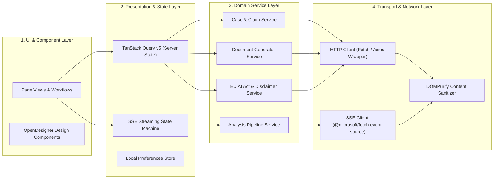
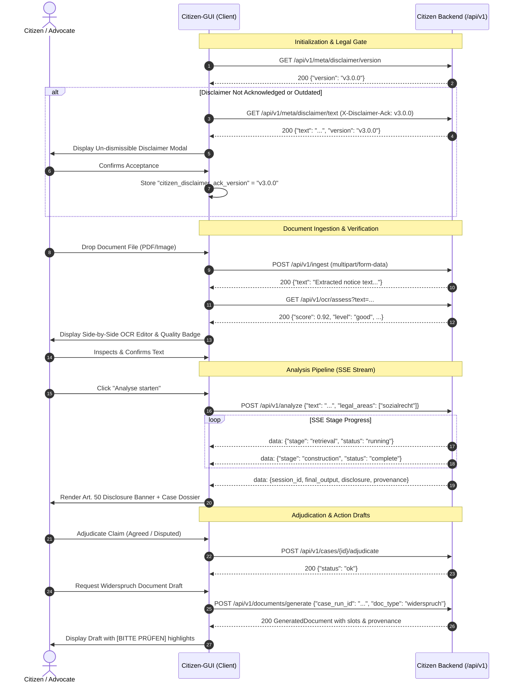

# Citizen-GUI — System Architecture & Design Document (Doc 1)

- **Document Title:** Citizen-GUI System Architecture & Design Document
- **Document Version:** `1.0.0`
- **Date:** 2026-11-16
- **Status:** Approved (Interview Approved, Initial Delivery)
- **Author:** Principal Systems Architect
- **Target Backend:** Citizen Backend `v2.0.0+` / API `/api/v1`

---

## Revision History

| Version | Date | Author | Description of Changes |
|---|---|---|---|
| `1.0.0` | 2026-11-16 | Principal Systems Architect | Initial baseline architecture & design document for Citizen-GUI saved to `docs/01-DESIGN-DOCUMENT.md`. |

---

## 1. Overview & Goals

### 1.1 Purpose
Citizen-GUI is the dedicated, evidence-first web interface for **Citizen** (`v2.0.0+`), an open-source, local-first engine designed to analyze official German administrative notices (*Bescheide, Kündigungen, Mahnbescheide*). 

The application answers four core citizen questions without ambiguity or legal speculation:
1. **Was steht da drin?** (What does the document state?)
2. **Stimmt das?** (Is this legally accurate based on statutory texts and calculation rules?)
3. **Bis wann muss ich reagieren?** (What is the exact deadline, considering delivery fiction and holiday rollovers?)
4. **Was mache ich jetzt?** (What procedural action should I take?)

Citizen-GUI prepares structured attorney dossiers (*Mandatsvorbereitungs-Dossier*) and procedural document drafts (*Widerspruch, Überprüfungsantrag § 44 SGB X, Akteneinsichtsantrag § 25 SGB X*).

> **Statutory Notice Boundary:** Citizen-GUI provides legal information, not legal advice (*„Rechtsinformation, keine Rechtsberatung“*). It does not replace an attorney or authorized legal counseling center. The human user retains ultimate adjudication authority and signs all documents.

### 1.2 System Scope & Mission
- **Mission:** Provide an accessible, transparent, and sovereign interface that binds administrative claims directly to legal statutes (`pgvector` citations) and deterministic calculation engines.
- **Architectural Boundary:** Citizen-GUI is an independent Single Page Application (SPA). It contains zero business logic, zero local database ORM logic, and zero autonomous legal calculation algorithms. All parsing, OCR, statutory citations, and arithmetic calculations are strictly backend-authoritative via Citizen's versioned `/api/v1` REST and Server-Sent Events (SSE) interfaces.
- **Tone & Aesthetic:** Governed by `DESIGN.md` and `opendesigner/RATIONALE.md`: serious, authoritative, sober legal reference tool (`#334155` Charcoal Ink, `flat2` tonal style, WCAG 2.2 AA accessibility, 44 px minimum tap target padding, instant 0 ms keyboard transitions, and zero distracting animations on functional data).

---

## 2. Requirements & Constraints Summary

Every constraint defined in this section governs all subsequent sections and documents.

### 2.1 Functional Requirements (FR)
- **FR-01: Legal Disclaimer Gate:** Enforce mandatory disclaimer handshake (`GET /api/v1/meta/disclaimer/version` -> `X-Disclaimer-Ack: <version>`) across all API interactions. Any version mismatch (`403 disclaimer_version_mismatch`) must immediately block access and trigger re-acknowledgment.
- **FR-02: EU AI Act Compliance (Art. 50):**
  - *Art. 50(1) Notification:* Render explicit pre-result AI disclosure notification (`texts[lang]` from `GET /api/v1/meta/disclosure`) before displaying any AI-generated findings to the user.
  - *Art. 50(2) Provenance:* Preserve and display machine-readable provenance metadata (`citizen-provenance-v1.1`) across all case views, document previews, and exported artifacts.
- **FR-03: Multi-Format Document Ingestion & Verification:** Ingest notices via `POST /api/v1/ingest` (PDF, JPG, PNG, TXT, HTML, EML; up to 25 MB). Display OCR quality assessment (`GET /api/v1/ocr/assess`). Mandate human inspection and confirmation of extracted text prior to triggering pipeline analysis.
- **FR-04: Real-Time SSE Pipeline Streaming:** Execute analysis (`POST /api/v1/analyze`) with real-time SSE event consumption across 11 stages (`corpus_health`, `ocr_quality`, `normalization`, `classification`, `decomposition`, `retrieval`, `construction`, `verification`, `generation`, `adversarial_review`, `calculation_check`). Render stage transitions, live token generation, and the terminal payload.
- **FR-05: Dossier Presentation & Evidence Binding:** Present verified facts, legal deadline banners (Bekanntgabefiktion § 37 Abs. 2 SGB X, § 84 SGG, weekend/holiday rollovers), calculation discrepancy tables (§ 11b SGB II cascade: Jobcenter vs Correct cent-level delta), and atomic claims with verified/unverified badges linking to source text chunk drawers.
- **FR-06: Human Adjudication & Re-evaluation:** Support user adjudication (agree/dispute) on claims and report sections (`POST /api/v1/cases/{id}/adjudicate`), inline editing of claims (`PATCH /api/v1/cases/{id}/claims/{claim_id}`), and single-stage targeted re-evaluations (`POST /api/v1/cases/{id}/reevaluate`).
- **FR-07: Procedural Document Generation:** Fetch generator options (`GET /api/v1/documents/generator-options/{case_run_id}`) and generate actionable drafts (`POST /api/v1/documents/generate`). Explicitly highlight unverified fields as `[BITTE PRÜFEN]` and populate user personal details locally into slots.
- **FR-08: Case Management & Export:** Provide a dashboard of the 100 most recent cases (`GET /api/v1/cases`), load individual cases (`GET /api/v1/cases/{id}`), support case deletion, and provide structured downloads in JSON and Markdown formats.
- **FR-09: Conversational & Intake Journeys:** Support chat-first workflows with document attachments (`/api/v1/conversations`) and multi-turn intake interviews (`/api/v1/intake/...`).
- **FR-10: System & Corpus Diagnostics:** Surface read-only module catalogs (`/api/v1/modules`), corpus health indicators (`/api/v1/corpus/health`), one-shot corpus update triggers (`POST /api/v1/corpus/update`), and Prüfstand goldset inspection/reports (`/api/v1/goldset`, `/api/v1/eval/reports`).

### 2.2 System Constraints (C) & Traceability Matrix

| ID | Constraint Definition | Governing Rationale | Honoring Section(s) |
|---|---|---|---|
| **C-01** | **Stateless GUI Architecture:** The GUI repository contains no database or ORM logic. State resides solely in the Citizen backend. Client storage is limited to `localStorage` for ephemeral preferences (disclaimer version, active theme, draft form state). | Architectural boundary (`README.md`) | §3.2, §5.2 |
| **C-02** | **No Application User Auth:** The backend is local-first without built-in user accounts. The GUI must not invent login/password mechanics; external authentication must be delegated to reverse proxies. | Citizen API Doc § 4 | §3.3, §7.1 |
| **C-03** | **Network Timeout Budget (540s SSE):** Analysis pipelines run up to 480 s (`PIPELINE_TIMEOUT_SEC`). Reverse proxy and HTTP client configurations must support ≥ 540 s timeouts without packet buffering. | Citizen API Doc § 7.1 | §3.3, §8.2 |
| **C-04** | **OpenDesigner Token & Standards Strictness:** Visual design must strictly consume generated CSS/Tailwind tokens (`#334155`, `flat2`, WCAG 2.2 AA contrast ≥ 4.5:1, 44 px touch padding, 0 ms keyboard animations, calm 200 ms fades). No arbitrary CSS color/spacing literals. | `AGENTS.md`, `DESIGN.md`, `standards.md` | §3.2, §10.2 |
| **C-05** | **Deterministic Engine Separation:** No legal arithmetic, deadline calculations, or statutory logic may be coded on the client. The frontend is purely a presentation and adjudication engine. | `CITIZEN-README.md` | §4.5, §6.2 |
| **C-06** | **Dev-Mode Upload Tagging:** In `DEPLOYMENT_MODE=dev`, all file uploads must pass `X-Document-Tag: synthetic` or `goldset` to comply with EU AI Act Art. 2(8) development exemptions. | Citizen API Doc § 4 | §6.3, §7.4 |
| **C-07** | **Zero Unsanitized HTML/Markdown:** All markdown and HTML strings from the API (disclaimer HTML, generated document markdown, AI outputs) must pass DOMPurify sanitization before insertion into the DOM. | Security best practice | §7.3 |

---

## 3. System Architecture

### 3.1 High-Level Topology

```mermaid
flowchart TD
    User["Citizen / Advocate Browser"]
    
    subgraph Container_Host ["Citizen Docker Compose Host"]
        subgraph Frontend_Pod ["citizen-gui (Nginx Container :3000)"]
            Nginx["Nginx Reverse Proxy & Static File Server"]
            SPA["React 19 Static SPA Bundle"]
        end
        
        subgraph Backend_Pod ["citizen-app (FastAPI Container :8000)"]
            FastAPI["FastAPI Engine (/api/v1)"]
            Middleware["Disclaimer & Header Guards"]
            Pipeline["Analysis Pipeline & OCR"]
            Calc["Deterministic Calculator & SGB II Cascade"]
        end
        
        subgraph Data_Pod ["Database Container :5432"]
            PG[("PostgreSQL 16 + pgvector")]
        end
    end
    
    User -->|HTTP / SSE :3000| Nginx
    Nginx -->|Serves Static HTML/JS/CSS| SPA
    Nginx -->|Reverse Proxy /api/v1 (Timeout: 540s, No Buffering)| FastAPI
    FastAPI --> Middleware
    Middleware --> Pipeline
    Pipeline --> Calc
    Pipeline --> PG
```

### 3.2 Client Layered Architecture

Citizen-GUI follows a strict unidirectional, four-layer Single Page Application architecture:



- **UI & Component Layer:** Clean separation between layout templates and reusable OpenDesigner-compliant components (buttons, input fields, badges, drawers, cards). All styling is bound to OpenDesigner tokens via Tailwind CSS classes.
- **Presentation & State Layer:**
  - *Server State:* TanStack Query v5 manages asynchronous queries and mutations (cases, presets, modules, options) with aggressive cache deduplication and optimistic updates for adjudications.
  - *Streaming State Machine:* A custom reactive state machine models the 11 SSE pipeline stages (`idle` -> `connecting` -> `streaming [stages 1..11]` -> `complete` / `error`).
  - *Local Preferences:* Synchronous storage wrapper for non-sensitive local keys (disclaimer acknowledgement, theme, dev upload tag).
- **Domain Service Layer:** Isolates domain models from raw network payloads, orchestrates validation, extracts Art. 50 disclosure payloads, and validates provenance metadata.
- **Transport & Network Layer:** Centralizes HTTP header injection (`X-Disclaimer-Ack`, `X-Document-Tag`), standardizes API error translation, and wraps streaming connections with automatic timeout watchdogs.

### 3.3 Deployment Topology & Reverse Proxy Architecture
To satisfy **[C-02]** (no user auth) and **[C-03]** (540 s SSE timeout), Citizen-GUI is packaged as an Alpine-based Nginx container running alongside `citizen-app` in Docker Compose:
- **Port Mapping:** Nginx binds to host port `3000` (configurable).
- **Static Assets:** Serves pre-compiled HTML, JS, CSS, and SVG assets with cache-control headers (`Cache-Control: public, max-age=31536000, immutable` for versioned chunks; `no-cache` for `index.html`).
- **Proxy Routing:** Requests to `/api/` are forwarded internally to `http://citizen-app:8000/api/`.
  - `proxy_buffering off;` and `proxy_cache off;` are enforced to prevent buffering SSE chunks.
  - `proxy_read_timeout 540s;` and `proxy_send_timeout 540s;` prevent premature connection termination during deep LLM reasoning.

---

## 4. Component Responsibilities

Citizen-GUI is organized into 11 cohesive modules:

```mermaid
classDiagram
    class AppShell {
        +renderNavigation()
        +renderSystemStatusBadge()
        +renderThemeToggle()
        +mountDisclaimerModal()
    }
    class LegalComplianceModule {
        +checkDisclaimerVersion()
        +recordDisclaimerAck()
        +enforceArt50DisclosureGate()
        +renderProvenanceBadge()
    }
    class IngestionModule {
        +handleFileUpload(file)
        +fetchOcrAssessment(text)
        +renderTextCorrectionView(text)
        +confirmExtractedText()
    }
    class AnalysisPipelineModule {
        +selectLegalAreas(areas)
        +applyPreset(presetId)
        +openSseStream(text, areas)
        +trackPipelineStages()
        +resolveTerminalPayload()
    }
    class DossierViewerModule {
        +renderExecutiveSummary()
        +renderDeadlineBanner()
        +renderCalculationCascade()
        +renderClaimsList()
        +openCitationDrawer(chunkId)
    }
    class AdjudicationModule {
        +toggleClaimStatus(claimId, status)
        +toggleSectionStatus(sectionKey, status)
        +editClaimText(claimId, text)
        +triggerReevaluation(stage, context)
    }
    class DocumentGeneratorModule {
        +fetchOptions(caseRunId)
        +selectDocumentType(type)
        +populateUserData(userData)
        +highlightUnverifiedSlots()
        +downloadDraft()
    }
    class ConversationModule {
        +listConversations()
        +createConversation(title, file)
        +streamChatMessage(message)
        +attachDocument(file)
    }
    class IntakeModule {
        +startIntake(initialText)
        +submitTurnMessage(message)
        +confirmIntake()
        +resetIntake()
    }
    class DiagnosticsModule {
        +listLegalModules()
        +fetchCorpusHealth()
        +triggerCorpusUpdate(sources)
        +listGoldsetsAndReports()
    }
    class ApiClientTransport {
        +request(config)
        +streamEvents(url, body, handlers)
        +interceptDisclaimerError()
        +sanitize(rawHtmlOrMarkdown)
    }

    AppShell --> LegalComplianceModule
    LegalComplianceModule --> ApiClientTransport
    IngestionModule --> ApiClientTransport
    AnalysisPipelineModule --> ApiClientTransport
    DossierViewerModule --> AdjudicationModule
    DossierViewerModule --> ApiClientTransport
    AdjudicationModule --> ApiClientTransport
    DocumentGeneratorModule --> ApiClientTransport
    ConversationModule --> ApiClientTransport
    IntakeModule --> ApiClientTransport
    DiagnosticsModule --> ApiClientTransport
```



### 4.1 App Shell & Navigation
- Hosts top application bar, primary navigation tabs (Case Journey, Conversations, Intake, Case Archive), and secondary diagnostic drawer (Prüfstand, Modules, Corpus).
- Displays backend status indicator based on periodic liveness probes (`GET /health`) and legal timestamp freshness (`GET /api/v1/meta/legal-timestamp`).
- Renders global warning banners when backend is in development mode (`GET /api/v1/meta/deployment-mode`).

### 4.2 Legal Compliance Module
- Intercepts all application bootstrap logic to verify the backend disclaimer version against `localStorage`.
- Presents an un-dismissible modal displaying the official German disclaimer text (`GET /api/v1/meta/disclaimer/text`) if unconfirmed or outdated.
- Blocks rendering of analysis results until the user has seen the Art. 50(1) notification.
- Injects `citizen-provenance-v1.1` tags into all UI views and export files.

### 4.3 Ingestion & OCR Verification Module
- Drag-and-drop document upload supporting PDF, JPG, PNG, TXT, HTML, and EML formats.
- Pre-upload client validation: verifies file size does not exceed 25 MB (`MAX_FILE_SIZE_MB`).
- Executes `POST /api/v1/ingest` and passes the extracted text to `GET /api/v1/ocr/assess`.
- Renders an OCR confidence card (score, warnings, readable word percentage).
- Presents a side-by-side text editor allowing the citizen to inspect and correct OCR errors before analysis.

### 4.4 Analysis Pipeline & SSE Module
- Manages pipeline execution configuration (legal area multi-selection or preset application).
- Initiates `POST /api/v1/analyze` and consumes SSE events via an event dispatcher.
- Visualizes 11 progress stages with real-time indicators:
  `corpus_health` -> `ocr_quality` -> `normalization` -> `classification` -> `decomposition` -> `retrieval` -> `construction` -> `verification` -> `generation` -> `adversarial_review` -> `calculation_check`.
- Handles streaming token text in real time during the construction stage.
- Catches terminal payload or stream-level error events (`{"error": "pipeline_failed"}`).

### 4.5 Dossier Viewer Module
- **Deadline Banner (Fristen):** Displays calculated statutory deadlines (e.g. 1-month Widerspruchsfrist under § 84 SGG, 4-day Bekanntgabefiktion under § 37 Abs. 2 SGB X, weekend/holiday rollovers under § 64 Abs. 3 SGG, or 1-year Jahresfrist under § 66 Abs. 2 SGG).
- **Calculation Cascade Table:** Presents a side-by-side financial breakdown comparing *Jobcenter Calculation* against *Legally Correct Calculation* with exact cent-level differences.
- **Claims & Evidence Bindings:** Renders atomic legal claims. Each claim displays an indicator badge:
  - `verified`: Verified against primary statutory chunk, displays citation.
  - `unverified`: Flagged with a warning badge.
- **Citation Drawer:** Clicking any evidence citation opens a slide-over drawer displaying the exact statutory paragraph, source authority, and chunk quotation.

### 4.6 Adjudication & Re-evaluation Module
- Provides interactive Agree / Dispute toggle buttons for each individual claim and report section (`POST /api/v1/cases/{case_id}/adjudicate`).
- Supports inline text corrections for claims (`PATCH /api/v1/cases/{case_id}/claims/{claim_id}`).
- Enables users to trigger targeted single-stage re-evaluations (e.g., re-running `calculation_check` with corrected income amounts).

### 4.7 Procedural Document Generator Module
- Calls `GET /api/v1/documents/generator-options/{case_run_id}` to retrieve applicable document templates.
- Renders a clean user input form for personal data (name, address, reference number / *Aktenzeichen*).
- Dispatches `POST /api/v1/documents/generate` to generate legal letter drafts (`widerspruch`, `ueberpruefungsantrag_44`, `akteneinsichtsantrag_25`).
- Visually highlights all unverified slots (`[BITTE PRÜFEN: ...]`) with an amber warning banner.
- Offers one-click markdown copy and clean PDF print export.

### 4.8 Conversation & Intake Modules
- **Conversation Module:** Renders chat interface with document attachment chips. Handles the initial pipeline run on the first message and transitions to grounded RAG chat on subsequent messages.
- **Intake Module:** Multi-turn structured pre-interview wizard. Tracks turn limits (2–12), renders questions, and passes final `IntakeResult` into the analysis pipeline.

### 4.9 Diagnostics & Prüfstand Module
- Dedicated secondary view for developers, testers, and administrative operators.
- Displays installed legal modules and their readiness status (`GET /api/v1/modules`).
- Monitors corpus chunk status and provides a manual corpus re-indexing trigger (`POST /api/v1/corpus/update`).
- Inspects goldset test cases (`GET /api/v1/goldset`) and renders evaluation regression reports (`GET /api/v1/eval/reports`).

---

## 5. Data Model

### 5.1 Domain Types (TypeScript Definitions)

```typescript
// --- Legal Compliance & Meta ---
export interface DisclaimerVersionResponse {
  version: string; // e.g. "v3.0.0"
}

export interface DisclaimerTextResponse {
  text: string; // Sanitized HTML
  version: string;
}

export interface Art50Disclosure {
  version: string;
  must_display_before: "results";
  texts: {
    de: string;
    en: string;
  };
}

export interface ProvenanceModule {
  id: string;
  version: string;
  parameter_set: string | null;
}

export interface ProvenancePayload {
  spec_version: "citizen-provenance-v1.1";
  generator: "citizen";
  app_version: string;
  model_profile: string;
  timestamp_utc: string;
  deployment_mode: "dev" | "self" | "provider";
  modules: ProvenanceModule[];
}

export interface DeploymentModeResponse {
  mode: "dev" | "self" | "provider";
  synthetic_data_only: boolean;
  dev: boolean;
  dev_banner: string | null;
}

// --- Ingestion & OCR ---
export interface IngestResponse {
  text: string;
}

export interface OcrAssessment {
  score: number; // 0.0 - 1.0
  level: "good" | "medium" | "poor";
  issues: string[];
  warnings: string[];
  ocr_artifacts_detected: boolean;
  readable_words_pct: number;
  language_detected: string;
  recommendations: string[];
}

// --- Analysis & Pipeline Streaming ---
export type PipelineStage =
  | "corpus_health"
  | "ocr_quality"
  | "normalization"
  | "classification"
  | "decomposition"
  | "retrieval"
  | "construction"
  | "verification"
  | "generation"
  | "adversarial_review"
  | "calculation_check";

export type StageStatus = "running" | "complete" | "ok" | "warning" | "info";

export interface SseStageEvent {
  stage: PipelineStage;
  status: StageStatus;
  payload: Record<string, unknown>;
}

export interface ResolvedModule {
  legal_area: string;
  module_id: string | null;
  module_version: string | null;
  legacy_alias: boolean;
  enabled: boolean;
}

export interface AnalysisFinalPayload {
  session_id: string;
  case_run_id: string;
  sections: string[];
  final_output: {
    sachverhalt?: string;
    ergebnis?: string;
    fristen?: Record<string, unknown>;
    berechnung?: Record<string, unknown>;
    adversarial_verhaeltnis?: Record<string, unknown>;
    [key: string]: unknown;
  };
  disclosure: Art50Disclosure;
  provenance: ProvenancePayload;
  resolved_modules?: ResolvedModule[];
}

// --- Cases & Adjudication ---
export interface EvidenceBinding {
  chunk_id: string;
  quote_excerpt: string;
  binding_strength: number; // 0.0 - 1.0
  verified: boolean;
}

export interface Claim {
  id: string;
  claim_text: string;
  confidence_score: number;
  claim_type: "fact" | "legal_finding" | "deadline" | "calculation";
  evidence_bindings: EvidenceBinding[];
  user_status?: "agreed" | "disputed";
  user_note?: string;
}

export interface CaseSummary {
  id: string;
  session_id: string;
  title: string;
  status: "completed" | "failed" | "processing";
  created_at: string;
  updated_at: string;
  input_preview: string;
  legal_areas: Array<{ legal_area: string; is_primary: boolean }>;
}

export interface CaseDetail extends CaseSummary {
  input_text: string;
  final_output: Record<string, unknown>;
  stages: Array<{ stage: PipelineStage; duration_ms: number; status: string }>;
  claims: Claim[];
  chat_history: Array<{ role: "user" | "assistant"; content: string; timestamp: string }>;
  user_edits: {
    edited_claims: Record<string, string>;
    section_adjudications: Record<string, "agreed" | "disputed">;
  };
}

// --- Document Generation ---
export interface DocumentGeneratorOption {
  doc_type: "widerspruch" | "widerspruch_jahresfrist" | "ueberpruefungsantrag_44" | "akteneinsichtsantrag_25";
  title: string;
  description: string;
  deadline_date?: string;
}

export interface DocumentSlot {
  key: string;
  value: string;
  verified: boolean;
  needs_review: boolean;
}

export interface GeneratedDocument {
  doc_type: string;
  title: string;
  rendered_text: string;
  slots: DocumentSlot[];
  generation_metadata: Record<string, unknown>;
  provenance: ProvenancePayload;
}
```

### 5.2 Client-Side Storage Schema (`localStorage`)
In compliance with **[C-01]**, client storage is strictly ephemeral and limited to:

| Storage Key | Type | Description | Eviction Policy |
|---|---|---|---|
| `citizen_disclaimer_ack_version` | `string` | Version string acknowledged by the user (e.g. `"v3.0.0"`). | Cleared on `403 disclaimer_version_mismatch`. |
| `citizen_ui_theme` | `"light" \| "dark" \| "system"` | Active visual theme. Defaults to `"system"`. | Permanent until user toggles. |
| `citizen_dev_document_tag` | `"synthetic" \| "goldset"` | Active upload tag used when `DEPLOYMENT_MODE=dev`. | Persists across dev sessions. |
| `citizen_draft_analysis_text` | `string` | Ephemeral draft text kept while citizen is editing OCR results. | Cleared on successful analysis start. |

---

## 6. API & Interface Design

### 6.1 Citizen API Endpoint Mapping



### 6.2 Endpoint Reference Matrix

| Category | Endpoint | Method | Headers Required | Payload / Purpose |
|---|---|---|---|---|
| **Meta** | `/meta/disclaimer/version` | `GET` | *None* | Retrieve required disclaimer version. |
| **Meta** | `/meta/disclaimer/text` | `GET` | `X-Disclaimer-Ack` | Retrieve official HTML disclaimer text. |
| **Meta** | `/meta/disclosure` | `GET` | `X-Disclaimer-Ack` | Retrieve Art. 50(1) notification text. |
| **Meta** | `/meta/deployment-mode` | `GET` | `X-Disclaimer-Ack` | Check `mode` (`dev`/`self`/`provider`). |
| **Ingestion** | `/ingest` | `POST` | `X-Disclaimer-Ack`, `X-Document-Tag` (in dev) | Upload file (PDF/Image) -> returns extracted text. |
| **OCR** | `/ocr/assess` | `GET` | `X-Disclaimer-Ack` | Evaluate extracted text OCR quality. |
| **Analysis** | `/analyze` | `POST` | `X-Disclaimer-Ack` | Run full analysis pipeline (SSE stream). |
| **Cases** | `/cases` | `GET` | `X-Disclaimer-Ack` | List 100 most recent completed cases. |
| **Cases** | `/cases/{case_id}` | `GET` | `X-Disclaimer-Ack` | Retrieve complete case detail, stages, and claims. |
| **Cases** | `/cases/{case_id}` | `DELETE` | `X-Disclaimer-Ack` | Delete case run. |
| **Cases** | `/cases/{case_id}/adjudicate` | `POST` | `X-Disclaimer-Ack` | Agree/dispute a claim or report section. |
| **Cases** | `/cases/{case_id}/claims/{claim_id}` | `PATCH` | `X-Disclaimer-Ack` | Update claim text / confidence. |
| **Cases** | `/cases/{case_id}/reevaluate` | `POST` | `X-Disclaimer-Ack` | Re-run single pipeline stage (SSE stream). |
| **Cases** | `/cases/{case_id}/chat` | `POST` | `X-Disclaimer-Ack` | Chat grounded in case context (SSE stream). |
| **Documents** | `/documents/generator-options/{case_run_id}` | `GET` | `X-Disclaimer-Ack` | Get valid document types for case. |
| **Documents** | `/documents/generate` | `POST` | `X-Disclaimer-Ack` | Generate procedural letter draft (Widerspruch). |
| **Modules** | `/modules` | `GET` | `X-Disclaimer-Ack` | List installed legal area modules & corpus readiness. |
| **Corpus** | `/corpus/health` | `GET` | `X-Disclaimer-Ack` | Ingested source types and chunk counts. |
| **Corpus** | `/corpus/update` | `POST` | `X-Disclaimer-Ack` | Trigger background scraping & chunk embedding. |
| **Goldsets** | `/goldset` | `GET` | `X-Disclaimer-Ack` | List synthetic verification goldset cases. |
| **Eval** | `/eval/reports` | `GET` | `X-Disclaimer-Ack` | List historical automated evaluation reports. |

### 6.3 Header Injection & Error Handling Rules
1. **Disclaimer Middleware:**
   - Every outbound HTTP and SSE request appends `X-Disclaimer-Ack: <stored_version>`.
   - On `403` with body `{"error": "disclaimer_version_mismatch"}`, the HTTP interceptor clears the local acknowledgement and triggers the global disclaimer modal.
2. **Dev-Mode Tagging:**
   - If `GET /meta/deployment-mode` returns `mode: "dev"`, every upload to `/ingest` or `/conversations` appends `X-Document-Tag: synthetic` (or `goldset`).
3. **Structured Error Handling:**
   - FastAPI validation failures (`422`) return an array of location errors; client formats them into friendly field warnings.
   - Structured domain errors (`409 corpus_not_ready`, `422 MODULE_NOT_ENABLED`) display direct corrective actions (e.g., prompt to update the corpus or enable the required module).
   - SSE terminal error events (`{"error": "pipeline_failed"}`) gracefully terminate the stream UI and display the backend failure message.

---

## 7. Security Architecture

### 7.1 Trust Boundary & Authentication Model
- **Local-First Boundary:** Citizen backend assumes all callers reaching its port are trusted. Citizen-GUI runs within the user's browser and communicates directly with the local host or via an authenticated ingress proxy.
- **No Client Credential Storage:** Citizen-GUI stores zero passwords, API keys, or long-lived authorization tokens.
- **Upstream Reverse Proxy Compatibility:** When deployed in multi-user or hosted environments, Citizen-GUI respects standard identity headers passed by upstream authenticating proxies (e.g., Authelia, OAuth2-Proxy).

### 7.2 Data Privacy & PII Handling
- **Backend Pseudonymization Awareness:** Direct personal identifiers (names, addresses, IBANs, Aktenzeichen) are stripped or replaced with typed tokens on the backend before any LLM inference occurs.
- **Client-Side Slot Hydration:** When generating procedural letters (*Widerspruch*), the citizen fills in personal information (name, address) inside the client browser. This user data is sent only to the local `/documents/generate` template compiler.

### 7.3 Content Security & Sanitization Policy
- **Strict DOM Sanitization:** To honor **[C-07]**, all dynamic markdown and HTML content rendered in the GUI (such as statutory chunk excerpts, disclaimer HTML, and document previews) must pass through `DOMPurify.sanitize()` using a strict profile permitting only structural formatting tags (`<p>`, `<b>`, `<i>`, `<ul>`, `<li>`, `<table>`, `<span>`, `<code>`).
- **Content Security Policy (CSP):** The production Nginx container serves the following HTTP header:
  ```http
  Content-Security-Policy: default-src 'self'; script-src 'self'; style-src 'self' 'unsafe-inline'; img-src 'self' data:; connect-src 'self'; font-src 'self'; object-src 'none'; frame-ancestors 'none';
  ```

### 7.4 Inference Profile Transparency
Citizen-GUI fetches `GET /api/v1/meta/active-profile` at startup and displays an info badge in the footer indicating whether LLM processing is local (`on-prem`), strictly within the EU with data processing agreements (`eu-avv`), or external (`extern-openrouter`).

---

## 8. Infrastructure & Deployment

### 8.1 Docker Multi-Stage Build

```dockerfile
# Stage 1: Build the React Application
FROM node:22-alpine AS builder
WORKDIR /app
COPY package*.json ./
RUN npm ci
COPY . .
RUN npm run build

# Stage 2: Serve via Nginx Unprivileged Alpine
FROM nginxinc/nginx-unprivileged:alpine-slim
COPY --from=builder /app/dist /usr/share/nginx/html
COPY nginx.conf /etc/nginx/conf.d/default.conf
EXPOSE 3000
CMD ["nginx", "-g", "daemon off;"]
```

### 8.2 Production Nginx Configuration
The Nginx configuration ensures static assets are served efficiently while proxying API requests with the necessary SSE streaming parameters (**[C-03]**):

```nginx
server {
    listen 3000;
    server_name localhost;

    root /usr/share/nginx/html;
    index index.html;

    # Gzip compression for static assets
    gzip on;
    gzip_types text/plain text/css application/json application/javascript text/xml application/xml text/javascript;

    # Single Page Application routing
    location / {
        try_files $uri $uri/ /index.html;
        add_header Cache-Control "no-cache, must-revalidate";
    }

    # Cache static chunks
    location /assets/ {
        expires 1y;
        add_header Cache-Control "public, max-age=31536000, immutable";
    }

    # Reverse proxy to Citizen FastAPI backend
    location /api/ {
        proxy_pass http://citizen-app:8000/api/;
        proxy_http_version 1.1;
        proxy_set_header Connection "";
        proxy_set_header Host $host;
        proxy_set_header X-Real-IP $remote_addr;
        proxy_set_header X-Forwarded-For $proxy_add_x_forwarded_for;
        proxy_set_header X-Forwarded-Proto $scheme;

        # SSE Streaming Settings (Crucial for 8-minute pipeline runs)
        proxy_buffering off;
        proxy_cache off;
        proxy_read_timeout 540s;
        proxy_send_timeout 540s;
        chunked_transfer_encoding on;
    }
}
```

### 8.3 Docker Compose Integration
Citizen-GUI integrates directly into the parent Citizen deployment stack:

```yaml
services:
  citizen-app:
    # Citizen FastAPI Backend Service (from citizen repo)
    image: citizen-backend:latest
    ports:
      - "8000:8000"
    networks:
      - citizen-net

  citizen-gui:
    build:
      context: .
      dockerfile: Dockerfile
    container_name: citizen-gui
    restart: unless-stopped
    ports:
      - "3000:3000"
    depends_on:
      - citizen-app
    networks:
      - citizen-net

networks:
  citizen-net:
    driver: bridge
```

---

## 9. Operational Model

### 9.1 Client Lifecycle & State Hydration
1. **Bootstrap Phase:**
   - App loads static bundle; reads theme from `localStorage` and applies theme class to `<html>`.
   - Dispatches parallel probes: `GET /health`, `GET /meta/disclaimer/version`, and `GET /meta/deployment-mode`.
2. **Gate Validation:**
   - If disclaimer version in `localStorage` does not match backend version, render `DisclaimerModal` and block navigation.
   - If `mode === "dev"`, activate prominent dev banner.
3. **Hydration Phase:**
   - Hydrate active module list (`GET /modules`) and presets (`GET /presets`).
   - Ready for user interactions.

### 9.2 Reliability & Watchdog Mechanisms
- **SSE Stream Watchdog:** If an SSE connection produces no events for 60 seconds during a running pipeline, the client emits a ping check. If disconnected unexpectedly, the client offers an immediate option to query `/api/v1/cases` to check if the analysis completed in the background.
- **Corpus Status Polling:** When a corpus update is triggered (`POST /api/v1/corpus/update`), the client polls `GET /api/v1/corpus/status/{job_id}` every 3 seconds with a 30-minute timeout ceiling, displaying chunk progress counters.

### 9.3 Performance Ceilings
- **Initial Bundle Size:** Core bundle < 250 KB gzipped.
- **First Contentful Paint (FCP):** < 1.0 s on standard desktop/mobile browsers.
- **Design Token Ingestion:** Tokens loaded via static CSS bundle to eliminate Flash of Unstyled Content (FOUC).

---

## 10. Key Design Decisions & ADRs

### ADR-01: React 19 + TypeScript (Strict Mode) + Vite
- **Context:** Citizen-GUI needs to manage complex interactive states (live 11-stage SSE streams, side-by-side text diffing, split-pane legal dossiers, interactive claim adjudication).
- **Decision:** Build as an SPA using React 19, TypeScript, and Vite.
- **Consequences:** Excellent component ecosystem, full type-safety matching backend schemas, fast HMR in development, and high-performance production builds.
- **[COMPLEXITY JUSTIFICATION]:** While a lighter framework (e.g. vanilla JS or Alpine) could render static forms, managing long-lived SSE streams, optimistic adjudication updates, and accessible interactive citation drawers would require writing bespoke state machines and DOM diffing engines. React provides these capabilities with zero custom framework maintenance.

### ADR-02: Direct Consumption of OpenDesigner Tokens via Tailwind CSS v4
- **Context:** OpenDesigner has generated canonical tokens in `opendesigner/tokens/` and compiled theme files in `opendesigner/build/tailwind/theme.css` and `opendesigner/build/css/tokens.css`.
- **Decision:** Consume the pre-compiled OpenDesigner Tailwind theme directly. Use Tailwind utility classes mapping strictly to the design system (e.g., `bg-primary`, `text-on-primary`, `rounded-control`, `p-container`).
- **Consequences:** Eliminates design drift, ensures 100% adherence to `DESIGN.md` and `opendesigner/standards.md`, and prevents hardcoded CSS literals.

### ADR-03: Header-Injectable SSE Streaming Client (`@microsoft/fetch-event-source`)
- **Context:** Citizen backend requires `X-Disclaimer-Ack` on all `/api/v1/*` routes including `POST /api/v1/analyze`. The standard browser `EventSource` API does not support custom HTTP headers or `POST` request bodies.
- **Decision:** Use `@microsoft/fetch-event-source` (or custom fetch-based reader) for all SSE streaming operations.
- **Consequences:** Enables custom headers on streaming endpoints, supports POST payloads with request bodies, and provides fine-grained error and reconnect lifecycle callbacks.
- **[COMPLEXITY JUSTIFICATION]:** The browser standard `EventSource` cannot send custom headers or execute POST requests, making it technically incapable of interacting with Citizen's authenticated pipeline without a backend rewrite.

### ADR-04: Dual-Surface Architecture (Primary Citizen Journey vs Diagnostics / Prüfstand)
- **Context:** Citizen API exposes developer-oriented evaluation endpoints (`/goldset`, `/eval/reports`, `/corpus/update`) alongside consumer-facing case workflows.
- **Decision:** Separate the UI into two distinct zones:
  1. The clean, distraction-free **Citizen / Advocate Surface** (Upload, Review, Dossier, Adjudication, Document Generator, Chat).
  2. A secondary, collapsible **System & Prüfstand Surface** accessible via the footer/drawer for developers and evaluators.
- **Consequences:** Keeps the primary legal inspection experience focused and accessible while providing immediate access to verification and evaluation tooling.

---

## 11. Open Questions & Assumptions

### 11.1 Validated Assumptions
- **[ASSUMPTION-01]:** Citizen-GUI runs on modern evergreen browsers (Chrome/Chromium 120+, Firefox 120+, Safari 17+) with native ES module, SSE, and flex/grid support.
- **[ASSUMPTION-02]:** Upstream Citizen backend runs on the same physical host or internal Docker bridge network, eliminating cross-origin latency on streaming endpoints.
- **[ASSUMPTION-03]:** All statutory calculation rules remain strictly on the backend; the GUI will never attempt to implement client-side date arithmetic or SGB II cascades.

### 11.2 Open Items for Operator Confirmation
- *Logo & Wordmark:* The OpenDesigner system notes that an official SVG logo/wordmark is pending (`H-logo` hook). The initial build will render a clean typographical wordmark using the primary brand color (`#334155`).
