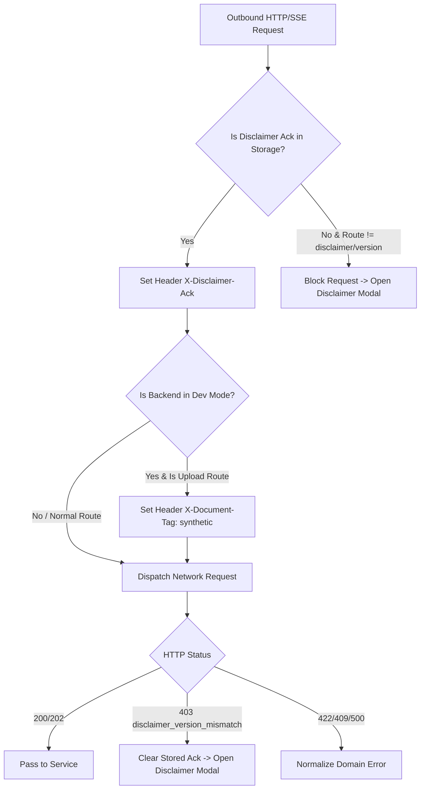

# Citizen-GUI — Technical Specification (Doc 2)

- **Document Title:** Citizen-GUI Technical Specification
- **Document Version:** `1.0.0`
- **Date:** 2026-11-16
- **Status:** Approved
- **Author:** Principal Systems Architect
- **Governing Architecture:** [Doc 1 v1.0.0](file:///home/daniel/projects/citizen-gui/docs/01-DESIGN-DOCUMENT.md)
- **Target Backend:** Citizen Backend `v2.0.0+` / REST & SSE API `/api/v1`

---

## Revision History

| Version | Date | Author | Description of Changes |
|---|---|---|---|
| `1.0.0` | 2026-11-16 | Principal Systems Architect | Initial formal Technical Specification (Doc 2) covering complete implementation scope, project structure, exact signatures, call traces, and executability seams. |

---

## 1. Implementation Scope

### 1.1 In-Scope Deliverables
A zero-context coding agent must implement the complete client-side system of Citizen-GUI matching the following specifications:
1. **Application Shell & Navigation:** Responsive layout, brand header (`#334155`), theme switcher (light/dark/system), system liveness badge (`GET /health`), dev-mode alert banner (`GET /api/v1/meta/deployment-mode`).
2. **Legal Compliance & Disclaimer Gate:** Global modal interceptor validating disclaimer version (`GET /api/v1/meta/disclaimer/version`) and enforcing acknowledgement before allowing route access. Mandatory display of EU AI Act Art. 50(1) notification (`GET /api/v1/meta/disclosure`) and Art. 50(2) machine-readable provenance display (`citizen-provenance-v1.1`).
3. **Document Ingestion & OCR Review:** File drag-and-drop supporting PDF, JPG, PNG, TXT, HTML, EML (up to 25 MB). Integration with `POST /api/v1/ingest` and `GET /api/v1/ocr/assess`. Split-pane text review and inline correction editor before pipeline submission.
4. **Analysis Pipeline & SSE Streaming:** Configurable pipeline launch with multi-area selection (`/api/v1/modules`) and preset selection (`/api/v1/presets`). Real-time SSE streaming client consuming 11 pipeline stages with live token generation, stage indicators, and error traps.
5. **Dossier & Adjudication View:** Statutory deadline banner (Bekanntgabefiktion § 37 Abs. 2 SGB X, § 84 SGG, rollover), side-by-side calculation cascade comparison table (§ 11b SGB II: Jobcenter vs Correct), claim cards with verification badges, citation slide-over drawer, claim agree/dispute toggles (`POST /api/v1/cases/{id}/adjudicate`), and single-stage targeted re-evaluation (`POST /api/v1/cases/{id}/reevaluate`).
6. **Procedural Document Generator:** Generation wizard for *Widerspruch*, *Überprüfungsantrag § 44 SGB X*, and *Akteneinsichtsantrag § 25 SGB X* (`POST /api/v1/documents/generate`). Slot-filling form for personal citizen details, warning badges on unverified `[BITTE PRÜFEN]` slots, and Markdown/PDF export.
7. **Conversations & Intake:** Chat-first document workflow (`/api/v1/conversations`) and multi-turn intake interview wizard (`/api/v1/intake/...`).
8. **System Diagnostics & Prüfstand:** Module catalog view (`/api/v1/modules`), corpus health monitor and re-indexing trigger (`/api/v1/corpus/health`, `/update`), and goldset test runner & eval report viewer (`/api/v1/goldset`, `/api/v1/eval/reports`).

### 1.2 Out-of-Scope (Explicit Boundaries)
- No client-side database (SQLite/IndexedDB ORM). Local persistence is strictly limited to ephemeral `localStorage` keys defined in [Doc 1 v1.0.0 §5.2](file:///home/daniel/projects/citizen-gui/docs/01-DESIGN-DOCUMENT.md#52-client-side-storage-schema-localstorage).
- No client-side user authentication system (delegated to network reverse-proxy per [Doc 1 v1.0.0 §2.2 C-02](file:///home/daniel/projects/citizen-gui/docs/01-DESIGN-DOCUMENT.md#22-system-constraints-c--traceability-matrix)).
- No client-side recalculation of legal dates or benefit math (backend-authoritative per [Doc 1 v1.0.0 §2.2 C-05](file:///home/daniel/projects/citizen-gui/docs/01-DESIGN-DOCUMENT.md#22-system-constraints-c--traceability-matrix)).

---

## 2. Project Structure

The project is structured as a modular React 19 + TypeScript + Vite repository. All source files reside in `src/`.

```
citizen-gui/
├── .gitignore
├── Dockerfile
├── nginx.conf
├── package.json
├── tsconfig.json
├── tsconfig.node.json
├── vite.config.ts
├── index.html
├── opendesigner/                      # Pre-existing design system tokens
│   ├── build/
│   │   ├── css/tokens.css             # Canonical CSS tokens
│   │   └── tailwind/theme.css         # Compiled Tailwind theme
│   └── standards.md
├── docs/
│   ├── 01-DESIGN-DOCUMENT.md
│   ├── 02-TECHNICAL-SPEC.md
│   ├── CITIZEN-API_DOCUMENTATION.md
│   └── CITIZEN-README.md
├── public/
│   └── favicon.svg
├── src/
│   ├── compositionRoot.ts             # Composition Root (Instantiates singletons)
│   ├── main.tsx                       # React DOM entry point
│   ├── App.tsx                        # Top-level application router & layout
│   ├── types/
│   │   ├── api.ts                     # Strict backend request/response types
│   │   ├── domain.ts                  # Internal GUI state models
│   │   └── events.ts                  # SSE event payload schemas
│   ├── services/
│   │   ├── http.ts                    # HTTP client wrapper with header interceptors
│   │   ├── sse.ts                     # Header-injectable SSE streaming client
│   │   ├── disclaimer.ts              # Legal disclaimer handshake service
│   │   ├── ingestion.ts               # File upload & OCR assessment service
│   │   ├── analysis.ts                # Analysis pipeline & case re-eval service
│   │   ├── cases.ts                   # Case listing, detail, & adjudication service
│   │   ├── documents.ts               # Procedural draft generation service
│   │   ├── conversations.ts           # Chat & document attachment service
│   │   ├── intake.ts                  # Multi-turn intake interview service
│   │   └── diagnostics.ts             # Modules, corpus & goldset service
│   ├── stores/
│   │   ├── localPreferences.ts        # Synchronous localStorage adapter
│   │   ├── streamingStore.ts          # Reactive pipeline state machine
│   │   └── complianceStore.ts         # Disclaimer & Art. 50 disclosure gate state
│   ├── components/
│   │   ├── common/
│   │   │   ├── Button.tsx
│   │   │   ├── Card.tsx
│   │   │   ├── Badge.tsx
│   │   │   ├── Modal.tsx
│   │   │   ├── Drawer.tsx
│   │   │   ├── Spinner.tsx
│   │   │   └── SanitizedHtml.tsx      # DOMPurify-wrapped renderer
│   │   ├── layout/
│   │   │   ├── Navbar.tsx
│   │   │   ├── Footer.tsx
│   │   │   ├── SystemStatusBanner.tsx
│   │   │   └── DisclaimerModal.tsx
│   │   ├── ingestion/
│   │   │   ├── Dropzone.tsx
│   │   │   ├── OcrQualityBadge.tsx
│   │   │   └── TextCorrectionEditor.tsx
│   │   ├── pipeline/
│   │   │   ├── StageTimeline.tsx
│   │   │   ├── LiveTokenStream.tsx
│   │   │   └── StageErrorAlert.tsx
│   │   ├── dossier/
│   │   │   ├── DeadlineBanner.tsx
│   │   │   ├── CalculationTable.tsx
│   │   │   ├── ClaimCard.tsx
│   │   │   ├── EvidenceCitationDrawer.tsx
│   │   │   └── AdversarialReviewCard.tsx
│   │   ├── documents/
│   │   │   ├── DocumentGeneratorForm.tsx
│   │   │   ├── UnverifiedSlotAlert.tsx
│   │   │   └── DocumentPreview.tsx
│   │   ├── conversations/
│   │   │   ├── ChatWindow.tsx
│   │   │   └── DocumentAttachmentList.tsx
│   │   ├── intake/
│   │   │   ├── IntakeWizard.tsx
│   │   │   └── TurnCounter.tsx
│   │   └── diagnostics/
│   │       ├── ModuleCatalogTable.tsx
│   │       ├── CorpusHealthMonitor.tsx
│   │       └── GoldsetReportViewer.tsx
│   └── views/
│       ├── AnalyzeView.tsx            # Ingest -> Review -> Stream -> Dossier
│       ├── CaseDetailView.tsx         # Direct view of existing case run
│       ├── CaseArchiveView.tsx        # List of past cases
│       ├── ConversationView.tsx       # Interactive chat flow
│       ├── IntakeView.tsx             # Interactive wizard flow
│       └── DiagnosticsView.tsx        # Admin/Prüfstand view
└── tests/
    ├── setup.ts
    ├── mocks/
    │   ├── handlers.ts                # MSW v2 mock API routes
    │   └── server.ts
    ├── unit/
    │   ├── disclaimer.test.ts
    │   ├── sse.test.ts
    │   ├── sanitization.test.ts
    │   └── stores.test.ts
    └── integration/
        ├── ingestion-to-analysis.test.ts
        ├── adjudication-flow.test.ts
        └── document-generation.test.ts
```

---

## 3. Dependencies

The exact production and development dependencies are pinned below.

```json
{
  "name": "citizen-gui",
  "private": true,
  "version": "1.0.0",
  "type": "module",
  "scripts": {
    "dev": "vite",
    "build": "tsc -b && vite build",
    "preview": "vite preview",
    "test": "vitest run",
    "test:watch": "vitest",
    "lint": "eslint src/ --ext .ts,.tsx"
  },
  "dependencies": {
    "@microsoft/fetch-event-source": "2.0.1",
    "@tanstack/react-query": "5.60.5",
    "clsx": "2.1.1",
    "dompurify": "3.2.1",
    "lucide-react": "0.460.0",
    "react": "19.0.0",
    "react-dom": "19.0.0",
    "react-router-dom": "7.0.1",
    "tailwind-merge": "2.5.4"
  },
  "devDependencies": {
    "@tailwindcss/vite": "4.0.0-beta.8",
    "@testing-library/jest-dom": "6.6.3",
    "@testing-library/react": "16.0.1",
    "@types/dompurify": "3.0.5",
    "@types/node": "22.9.0",
    "@types/react": "19.0.0",
    "@types/react-dom": "19.0.0",
    "@vitejs/plugin-react": "4.3.3",
    "eslint": "9.15.0",
    "jsdom": "25.0.1",
    "msw": "2.6.5",
    "tailwindcss": "4.0.0-beta.8",
    "typescript": "5.6.3",
    "vite": "6.0.0",
    "vitest": "2.1.5"
  }
}
```

---

## 4. Configuration

### 4.1 TypeScript Configuration (`tsconfig.json`)
Strict mode enforced. Path aliases ensure unambiguous imports.

```json
{
  "compilerOptions": {
    "target": "ES2022",
    "useDefineForClassFields": true,
    "lib": ["ES2022", "DOM", "DOM.Iterable"],
    "module": "ESNext",
    "skipLibCheck": true,
    "moduleResolution": "bundler",
    "allowImportingTsExtensions": false,
    "resolveJsonModule": true,
    "isolatedModules": true,
    "moduleDetection": "force",
    "noEmit": true,
    "jsx": "react-jsx",
    "strict": true,
    "noUnusedLocals": true,
    "noUnusedParameters": true,
    "noFallthroughCasesInSwitch": true,
    "noUncheckedIndexedAccess": true,
    "baseUrl": ".",
    "paths": {
      "@/*": ["src/*"]
    }
  },
  "include": ["src"]
}
```

### 4.2 Vite Configuration (`vite.config.ts`)
Dev server replicates production Nginx routing, proxying `/api/` to Citizen backend on `http://localhost:8000`.

```typescript
import { defineConfig } from 'vite';
import react from '@vitejs/plugin-react';
import tailwindcss from '@tailwindcss/vite';
import path from 'path';

export default defineConfig({
  plugins: [react(), tailwindcss()],
  resolve: {
    alias: {
      '@': path.resolve(__dirname, './src'),
    },
  },
  server: {
    port: 3000,
    proxy: {
      '/api': {
        target: process.env.VITE_CITIZEN_API_TARGET || 'http://localhost:8000',
        changeOrigin: true,
        // Match 540s backend timeout budget (Doc 1 §2.2 C-03)
        timeout: 540000,
      },
    },
  },
});
```

### 4.3 Styling Configuration
OpenDesigner tokens are directly imported into the root CSS stylesheet (`src/index.css`), honoring **[Doc 1 v1.0.0 §2.2 C-04]**:

```css
@import "tailwindcss";
@import "../opendesigner/build/css/tokens.css";
@import "../opendesigner/build/tailwind/theme.css";

/* Base Accessibility Enforcements */
:focus-visible {
  outline: 2px solid var(--color-primary, #334155);
  outline-offset: 2px;
}

@media (prefers-reduced-motion: reduce) {
  * {
    animation-duration: 0.01ms !important;
    animation-iteration-count: 1 !important;
    transition-duration: 0.01ms !important;
  }
}
```

---

## 5. Data Layer & Type Closure

Every entity is explicitly typed below with zero external generic dependencies.

```typescript
// ==========================================
// 1. Legal Compliance, Meta & Provenance
// ==========================================
export interface DisclaimerVersionResponse {
  version: string;
}

export interface DisclaimerTextResponse {
  text: string;
  version: string;
}

export interface Art50Disclosure {
  version: string;
  must_display_before: "results";
  texts: {
    de: string;
    en: string;
  };
}

export interface ProvenanceModule {
  id: string;
  version: string;
  parameter_set: string | null;
}

export interface ProvenancePayload {
  spec_version: "citizen-provenance-v1.1";
  generator: "citizen";
  app_version: string;
  model_profile: string;
  timestamp_utc: string;
  deployment_mode: "dev" | "self" | "provider";
  modules: ProvenanceModule[];
}

export interface DeploymentModeResponse {
  mode: "dev" | "self" | "provider";
  synthetic_data_only: boolean;
  dev: boolean;
  dev_banner: string | null;
}

export interface LegalTimestampResponse {
  parameter_freshness: string | null;
  corpus_freshness: string | null;
}

export interface HealthResponse {
  status: "ok";
  version: string;
}

// ==========================================
// 2. Ingestion & OCR Quality
// ==========================================
export interface IngestResponse {
  text: string;
}

export interface OcrAssessmentResponse {
  score: number;
  level: "good" | "medium" | "poor";
  issues: string[];
  warnings: string[];
  ocr_artifacts_detected: boolean;
  readable_words_pct: number;
  language_detected: string;
  recommendations: string[];
}

// ==========================================
// 3. Analysis Pipeline & Streaming
// ==========================================
export type PipelineStage =
  | "corpus_health"
  | "ocr_quality"
  | "normalization"
  | "classification"
  | "decomposition"
  | "retrieval"
  | "construction"
  | "verification"
  | "generation"
  | "adversarial_review"
  | "calculation_check";

export type StageStatus = "running" | "complete" | "ok" | "warning" | "info";

export interface SseStageEventPayload {
  stage: PipelineStage;
  status: StageStatus;
  payload: Record<string, unknown>;
}

export interface ResolvedModule {
  legal_area: string;
  module_id: string | null;
  module_version: string | null;
  legacy_alias: boolean;
  enabled: boolean;
}

export interface FinalOutputStructure {
  sachverhalt?: string;
  ergebnis?: string;
  fristen?: {
    bescheid_datum?: string;
    zustellungs_fiktion?: string;
    frist_ende?: string;
    feiertags_rollover?: boolean;
    rechtsbehelfsbelehrung_korrekt?: boolean;
    gesetzliche_grundlage?: string;
  };
  berechnung?: {
    anspruch_ermittelt_cent: number;
    anspruch_bescheid_cent: number;
    differenz_cent: number;
    positionen: Array<{
      bezeichnung: string;
      behoerde_cent: number;
      korrekt_cent: number;
      abwaegungsgrundlage: string;
    }>;
  };
  adversarial_verhaeltnis?: {
    behoerden_sicht: string;
    buerger_sicht: string;
    risiko_einschaetzung: string;
  };
  [key: string]: unknown;
}

export interface AnalysisFinalEventPayload {
  session_id: string;
  case_run_id: string;
  sections: string[];
  final_output: FinalOutputStructure;
  disclosure: Art50Disclosure;
  provenance: ProvenancePayload;
  resolved_modules?: ResolvedModule[];
}

export interface AnalysisErrorEventPayload {
  error: string;
  detail?: string;
  session_id?: string;
}

// ==========================================
// 4. Case Management & Claims
// ==========================================
export interface EvidenceBinding {
  chunk_id: string;
  quote_excerpt: string;
  binding_strength: number;
  verified: boolean;
}

export interface Claim {
  id: string;
  claim_text: string;
  confidence_score: number;
  claim_type: "fact" | "legal_finding" | "deadline" | "calculation";
  evidence_bindings: EvidenceBinding[];
  user_status?: "agreed" | "disputed";
  user_note?: string;
}

export interface CaseSummary {
  id: string;
  session_id: string;
  title: string;
  status: "completed" | "failed" | "processing";
  created_at: string;
  updated_at: string;
  input_preview: string;
  legal_areas: Array<{ legal_area: string; is_primary: boolean }>;
}

export interface CaseDetail extends CaseSummary {
  input_text: string;
  final_output: FinalOutputStructure;
  stages: Array<{ stage: PipelineStage; duration_ms: number; status: string }>;
  claims: Claim[];
  chat_history: Array<{ role: "user" | "assistant"; content: string; timestamp: string }>;
  user_edits: {
    edited_claims: Record<string, string>;
    section_adjudications: Record<string, "agreed" | "disputed">;
  };
}

export interface AdjudicatePayload {
  target_type: "claim" | "section";
  target_id: string;
  status: "agreed" | "disputed";
  note?: string;
}

// ==========================================
// 5. Document Generation
// ==========================================
export interface GeneratorOptionsResponse {
  case_run_id: string;
  available_doc_types: Array<{
    doc_type: "widerspruch" | "widerspruch_jahresfrist" | "ueberpruefungsantrag_44" | "akteneinsichtsantrag_25";
    title: string;
    description: string;
  }>;
  frist_info?: {
    datum: string;
    ist_jahresfrist: boolean;
  };
  user_slots_required: string[];
}

export interface GenerateDocumentRequest {
  case_run_id: string;
  doc_type?: "widerspruch" | "widerspruch_jahresfrist" | "ueberpruefungsantrag_44" | "akteneinsichtsantrag_25";
  user_data: {
    name: string;
    adresse: string;
    aktenzeichen?: string;
    [key: string]: string | undefined;
  };
}

export interface DocumentSlot {
  key: string;
  value: string;
  verified: boolean;
  needs_review: boolean;
}

export interface GeneratedDocumentResponse {
  doc_type: string;
  title: string;
  rendered_text: string;
  slots: DocumentSlot[];
  generation_metadata: {
    selected_by: string;
    frist_am?: string;
    [key: string]: unknown;
  };
  provenance: ProvenancePayload;
}

// ==========================================
// 6. Legal Modules & Diagnostics
// ==========================================
export interface ModuleSummary {
  id: string;
  version: string;
  tier: "verified" | "experimental";
  enabled: boolean;
  is_default: boolean;
  title: {
    de: string;
    en: string;
  };
  area_keys: string[];
  corpus: {
    chunk_count: number;
    source_types: string[];
    present_source_types: string[];
    missing_source_types: string[];
    is_ready: boolean;
  } | null;
  installed_at: string | null;
}

export interface ModulesCatalogResponse {
  default_module: string;
  modules: ModuleSummary[];
}

export interface CorpusHealthSource {
  type: string;
  chunk_count: number;
  last_updated: string;
}

export interface CorpusHealthResponse {
  total_chunks: number;
  total_sources: number;
  is_healthy: boolean;
  sources: CorpusHealthSource[];
  warnings: string[];
}

export interface CorpusUpdateResponse {
  job_id: string;
  status: "queued";
}

export interface CorpusJobStatusResponse {
  job_id: string;
  status: "queued" | "running" | "completed" | "failed";
  substage: "scraping" | "embedding" | null;
  chunks_scraped: number;
  chunks_processed: number;
  chunks_embedded: number;
  chunks_upserted: number;
}
```

---

## 7. Authentication & Authorization (AuthN/AuthZ)

Citizen operates under a local-first, zero-user-auth security model (**[Doc 1 v1.0.0 §2.2 C-02]**). Integrity and compliance are maintained through strict header gates:



### 7.1 Header Gate Specifications
1. **`X-Disclaimer-Ack` Header:**
   - Injected into all requests to `/api/v1/*` except `/api/v1/meta/disclaimer/version` and `/health`.
   - Value is the exact version string obtained from `GET /api/v1/meta/disclaimer/version` (e.g. `"v3.0.0"`).
   - If missing or outdated, backend returns `403` with body `{"error": "disclaimer_version_mismatch", "required_version": "v3.0.0"}`.
2. **`X-Document-Tag` Header:**
   - Evaluated during bootstrap via `GET /api/v1/meta/deployment-mode`.
   - When `mode === "dev"`, every file upload to `POST /api/v1/ingest` and `POST /api/v1/conversations/{id}/documents` MUST append `X-Document-Tag: synthetic` (or `goldset`).
   - Failure to pass this header on dev instances yields `403 {"detail": {"error": "synthetic_data_only"}}`.

---

## 8. Module Specifications

### 8.1 Module: `http` (HTTP Transport Client)
- **File:** `src/services/http.ts`
- **Constructor / Invoker:** Instantiated in `src/compositionRoot.ts`.
- **Public Methods:**
  - `request<T>(config: RequestConfig): Promise<T>`
  - `upload<T>(url: string, file: File, additionalFields?: Record<string, string>): Promise<T>`
- **Errors:** Emits `ApiError` with normalized fields `{ status: number, error: string, message: string, details?: unknown }`. Catches `403 disclaimer_version_mismatch` and calls `complianceStore.handleVersionMismatch()`.

### 8.2 Module: `sse` (Streaming Transport Client)
- **File:** `src/services/sse.ts`
- **Constructor / Invoker:** Instantiated in `src/compositionRoot.ts`.
- **Public Methods:**
  - `streamPipeline(endpoint: string, body: unknown, callbacks: SseCallbacks): Promise<void>`
- **Signature:**
  ```typescript
  export interface SseCallbacks {
    onStageEvent: (event: SseStageEventPayload) => void;
    onToken?: (token: string) => void;
    onFinal: (payload: AnalysisFinalEventPayload) => void;
    onError: (error: AnalysisErrorEventPayload) => void;
  }
  ```
- **Behavior:** Implements `@microsoft/fetch-event-source`. Uses a 60-second inactivity watchdog. If no event arrives within 60 s, logs heartbeat warning. Closes stream immediately upon receiving `final` event or error event.

### 8.3 Module: `disclaimer` (Compliance Service)
- **File:** `src/services/disclaimer.ts`
- **Caller:** `AppShell`, `compositionRoot.ts`.
- **Methods:**
  - `checkVersion(): Promise<{ isCurrent: boolean, currentVersion: string }>`
  - `fetchDisclaimerText(): Promise<DisclaimerTextResponse>`
  - `acknowledge(version: string): void`
  - `fetchDisclosure(): Promise<Art50Disclosure>`
- **Behavior:** Reads/writes `citizen_disclaimer_ack_version` in `localPreferencesStore`.

### 8.4 Module: `ingestion` (Document Ingestion Service)
- **File:** `src/services/ingestion.ts`
- **Caller:** `AnalyzeView`, `Dropzone`.
- **Methods:**
  - `uploadDocument(file: File): Promise<IngestResponse>`
  - `assessQuality(text: string): Promise<OcrAssessmentResponse>`
- **Behavior:** Injects `X-Document-Tag: synthetic` if `localPreferencesStore.isDevMode()` is active. Enforces `file.size <= 25 * 1024 * 1024` client-side.

### 8.5 Module: `analysis` (Analysis Pipeline Service)
- **File:** `src/services/analysis.ts`
- **Caller:** `AnalyzeView`.
- **Methods:**
  - `startAnalysis(text: string, legalAreas: string[]): Promise<void>`
  - `reevaluateStage(caseId: string, stage: PipelineStage, context: string): Promise<void>`
- **Behavior:** Dispatches streaming requests via `sse.ts` and commits stage transitions directly to `streamingStore`.

### 8.6 Module: `cases` (Case & Adjudication Service)
- **File:** `src/services/cases.ts`
- **Caller:** `CaseArchiveView`, `CaseDetailView`, `ClaimCard`.
- **Methods:**
  - `listRecentCases(): Promise<CaseSummary[]>`
  - `getCase(caseId: string): Promise<CaseDetail>`
  - `deleteCase(caseId: string): Promise<void>`
  - `adjudicate(caseId: string, payload: AdjudicatePayload): Promise<void>`
  - `patchClaim(caseId: string, claimId: string, text: string): Promise<Claim>`
  - `downloadExport(caseId: string, format: "json" | "markdown"): Promise<Blob>`

### 8.7 Module: `documents` (Procedural Draft Service)
- **File:** `src/services/documents.ts`
- **Caller:** `DocumentGeneratorForm`.
- **Methods:**
  - `getOptions(caseRunId: string): Promise<GeneratorOptionsResponse>`
  - `generate(req: GenerateDocumentRequest): Promise<GeneratedDocumentResponse>`
- **Behavior:** Renders generated letters and identifies `[BITTE PRÜFEN]` patterns in `slots` to populate `needs_review` warning banners.

---

## 9. Background Jobs

Citizen-GUI runs three client-side background tasks:
1. **Corpus Polling Worker (`src/services/diagnostics.ts`):** When `triggerCorpusUpdate()` is initiated, an interval worker polls `GET /api/v1/corpus/status/{job_id}` every 3 seconds. Terminates when status reaches `"completed"` or `"failed"`, or after 30 minutes.
2. **SSE Stream Inactivity Watchdog (`src/services/sse.ts`):** Evaluates stream activity every 15 seconds during active pipeline runs. If zero events arrive for 60 seconds, warns the user that LLM reasoning is taking longer than expected.
3. **Backend Health Liveness Probe (`src/components/layout/SystemStatusBanner.tsx`):** Executes `GET /health` every 30 seconds to maintain the live backend connectivity indicator.

---

## 10. Observability

1. **Structured Console Logger:** Internal logs prefix messages with `[Citizen-GUI][<Module>]`. In development, logs full event payloads; in production, logs only lifecycle transitions and errors.
2. **React Error Boundary (`src/components/common/ErrorBoundary.tsx`):** Wraps all view components. Catches unhandled UI render errors and displays a localized, accessible error card with options to reload the application.
3. **Stream Health Monitor:** Calculates elapsed duration and per-stage latency during analysis runs, displaying progress in `StageTimeline.tsx`.

---

## 11. Error Handling Catalog

| HTTP Status | Trigger Condition | UI Surface | Corrective Action Presented to Citizen |
|---|---|---|---|
| `400` | Ingestion file > 25 MB or invalid file type | Dropzone Alert | "Die Datei überschreitet die Höchstgröße von 25 MB oder hat ein nicht unterstütztes Format." |
| `403` | Disclaimer version mismatch (`disclaimer_version_mismatch`) | Modal Dialog | Fullscreen un-dismissible modal displaying the updated legal notice. User must click "Zustimmen". |
| `403` | Missing synthetic data tag in dev mode | Upload Alert | Auto-sets `X-Document-Tag: synthetic` and prompts user to retry. |
| `404` | Case ID not found | View Container | "Der angeforderte Fall existiert nicht oder wurde gelöscht." (Button: Zur Übersicht). |
| `409` | Corpus chunks not ready (`corpus_not_ready`) | Analysis Banner | "Das Rechtsgebiet erfordert einen Korpus-Abgleich. Bitte starten Sie die Korpus-Aktualisierung im Prüfstand." |
| `422` | Legal module disabled (`MODULE_NOT_ENABLED`) | Pre-flight Badge | "Das Rechtsgebiet ist in dieser Instanz nicht aktiviert. Bitte wählen Sie Sozialrecht." |
| `500` | Internal engine failure | Toast Alert | "Ein interner Fehler ist aufgetreten. Bitte prüfen Sie die Backend-Logs." |
| Stream Error | Pipeline failed event (`pipeline_failed`) | Stage Timeline | Displays exact error message from backend stage (e.g. OCR failure, LLM timeout). |

---

## 12. Testing Strategy

### 12.1 Mandatory Test-Construction Rule
> **Binding Construction Rule:** A test may not hand-build the state the code under test is supposed to produce. Pre-existing state is established by calling the production path, never by direct fixture writes. A test that pre-builds its inputs verifies arithmetic while proving nothing about whether the pipeline can produce them.

### 12.2 Test Suite Architecture
- **Unit Tests (Vitest + jsdom):**
  - Disclaimer handshake verification (`tests/unit/disclaimer.test.ts`).
  - DOMPurify sanitization guard (`tests/unit/sanitization.test.ts`): Verifies XSS vectors (`<script>`, `onerror=`, `javascript:`) are eliminated from rendered markdown and disclaimer HTML.
  - Local preferences store schema validation (`tests/unit/stores.test.ts`).
- **Integration Tests (MSW v2 + Testing Library):**
  - Full ingestion-to-analysis workflow (`tests/integration/ingestion-to-analysis.test.ts`): File drop -> Ingest -> OCR confirm -> SSE stream -> Dossier render.
  - Adjudication flow (`tests/integration/adjudication-flow.test.ts`): Agree/Dispute toggle commits state via API mock and updates UI badge.
  - Document generation (`tests/integration/document-generation.test.ts`): Option fetch -> personal data entry -> draft preview with `[BITTE PRÜFEN]` highlighting.

---

## 13. Build, Run, and Deployment

### 13.1 Local Development Commands
```bash
# 1. Install pinned dependencies
npm ci

# 2. Start Vite development server on http://localhost:3000
npm run dev

# 3. Execute Vitest test suite
npm test

# 4. Run TypeScript and ESLint checks
npm run lint
```

### 13.2 Containerized Production Deployment
```bash
# 1. Build production Docker image
docker build -t citizen-gui:1.0.0 .

# 2. Run container standalone attached to Citizen network
docker run -d --name citizen-gui \
  -p 3000:3000 \
  --net citizen-net \
  citizen-gui:1.0.0
```

---

## 14. Acceptance Criteria

| ID | Category | Objective Testable Verification Condition |
|---|---|---|
| **AC-01** | Disclaimer Gate | App boot without stored disclaimer version halts at `DisclaimerModal`. No route allows bypass. Acknowledgment records version and unblocks UI. |
| **AC-02** | EU AI Act Art. 50 | Analysis results view refuses to render findings until Art. 50(1) notification is presented. Provenance banner displaying `spec_version: "citizen-provenance-v1.1"` is visible on all cases. |
| **AC-03** | Ingestion & OCR | Uploading a multi-page PDF extracts text via `POST /api/v1/ingest`, displays OCR score, and requires explicit user confirmation click before enabling "Analyse starten". |
| **AC-04** | SSE Streaming | `POST /api/v1/analyze` consumes all 11 stages sequentially. Construction stage renders live streaming tokens. Final event transitions cleanly to Dossier view. |
| **AC-05** | Dossier & Deadlines | Dossier renders: (1) Fristen banner with calculated date and rollover notice, (2) Side-by-side calculation comparison with correct cent delta, (3) Claims with verified/unverified badges. |
| **AC-06** | Adjudication | Clicking "Zustimmen" or "Widersprechen" on a claim sends `POST /api/v1/cases/{id}/adjudicate` and updates claim status badge immediately. |
| **AC-07** | Document Generator | Generating a *Widerspruch* replaces verified slots with citizen data and highlights any unverified slot with amber `[BITTE PRÜFEN]` indicator. |
| **AC-08** | Design Strictness | Visual rendering adheres to OpenDesigner tokens: `#334155` primary color, 44 px min tap targets, 2 px focus rings, and zero decorative animations on functional data. |

---

## 15. Seam Register & Call Traces

### 15.1 Composition Root
The single authoritative composition root is **`src/compositionRoot.ts`**. It instantiates and wires all singletons, storage adapters, and HTTP/SSE clients. No React component or UI service may instantiate network infrastructure directly.

```typescript
// src/compositionRoot.ts
import { LocalPreferencesStore } from './stores/localPreferences';
import { HttpClient } from './services/http';
import { SseClient } from './services/sse';
import { DisclaimerService } from './services/disclaimer';
import { IngestionService } from './services/ingestion';
import { AnalysisService } from './services/analysis';
import { CasesService } from './services/cases';
import { DocumentService } from './services/documents';
import { DiagnosticsService } from './services/diagnostics';

export class CompositionRoot {
  public static readonly prefs = new LocalPreferencesStore();
  public static readonly http = new HttpClient(CompositionRoot.prefs);
  public static readonly sse = new SseClient(CompositionRoot.prefs);

  public static readonly disclaimer = new DisclaimerService(CompositionRoot.http, CompositionRoot.prefs);
  public static readonly ingestion = new IngestionService(CompositionRoot.http, CompositionRoot.prefs);
  public static readonly analysis = new AnalysisService(CompositionRoot.sse);
  public static readonly cases = new CasesService(CompositionRoot.http);
  public static readonly documents = new DocumentService(CompositionRoot.http);
  public static readonly diagnostics = new DiagnosticsService(CompositionRoot.http);
}
```

### 15.2 Seam Register

| Seam ID | Caller Module | Caller Method | Callee Module | Callee Method | Parameter Types | Return Type | Protocol / Mechanism |
|---|---|---|---|---|---|---|---|
| **S-01** | `App.tsx` | `useEffect` | `DisclaimerService` | `checkVersion` | `()` | `Promise<{isCurrent: boolean, currentVersion: string}>` | Direct TS Call |
| **S-02** | `DisclaimerModal.tsx` | `handleAcknowledge` | `DisclaimerService` | `acknowledge` | `(version: string)` | `void` | Direct TS Call -> `localStorage` |
| **S-03** | `Dropzone.tsx` | `onDrop` | `IngestionService` | `uploadDocument` | `(file: File)` | `Promise<IngestResponse>` | `POST /api/v1/ingest` (multipart) |
| **S-04** | `AnalyzeView.tsx` | `handleStartAnalysis` | `AnalysisService` | `startAnalysis` | `(text: string, areas: string[])` | `Promise<void>` | `POST /api/v1/analyze` (SSE stream) |
| **S-05** | `ClaimCard.tsx` | `handleAdjudicate` | `CasesService` | `adjudicate` | `(caseId: string, payload: AdjudicatePayload)` | `Promise<void>` | `POST /api/v1/cases/{id}/adjudicate` |
| **S-06** | `DocumentGeneratorForm.tsx` | `handleSubmit` | `DocumentService` | `generate` | `(req: GenerateDocumentRequest)` | `Promise<GeneratedDocumentResponse>` | `POST /api/v1/documents/generate` |
| **S-07** | `CorpusHealthMonitor.tsx` | `handleUpdate` | `DiagnosticsService` | `triggerCorpusUpdate` | `(sources?: string[])` | `Promise<CorpusUpdateResponse>` | `POST /api/v1/corpus/update` |

### 15.3 Call Traces

#### Call Trace 1: Application Bootstrap & Disclaimer Handshake
```
1. Entry: Browser loads index.html -> src/main.tsx executes -> mounts <App />
2. App.tsx invokes CompositionRoot.disclaimer.checkVersion()
3. DisclaimerService calls HttpClient.request("GET", "/api/v1/meta/disclaimer/version")
   [Process Boundary: Browser -> Nginx (:3000) -> Citizen FastAPI (:8000)]
4. FastAPI returns 200 {"version": "v3.0.0"}
5. DisclaimerService reads "citizen_disclaimer_ack_version" from LocalPreferencesStore
6. Comparison: Stored version ("v3.0.0") === Backend version ("v3.0.0")
   - If Match: App renders primary navigation router.
   - If Mismatch / Null: App sets complianceStore.isDisclaimerModalOpen = true.
     -> DisclaimerModal opens displaying text from GET /api/v1/meta/disclaimer/text.
     -> User clicks "Zustimmen" -> invokes CompositionRoot.disclaimer.acknowledge("v3.0.0").
     -> LocalPreferencesStore persists "citizen_disclaimer_ack_version" = "v3.0.0".
7. Committed State: localStorage updated; complianceStore unlocked; App routes rendered.
```

#### Call Trace 2: Document Ingestion, OCR Verification & Human Confirmation
```
1. Entry: Citizen drops PDF file onto Dropzone in AnalyzeView.tsx
2. Dropzone validates file.size <= 25MB -> invokes CompositionRoot.ingestion.uploadDocument(file)
3. IngestionService attaches X-Disclaimer-Ack and (if dev) X-Document-Tag: synthetic
4. IngestionService calls HttpClient.upload("/api/v1/ingest", file)
   [Process Boundary: Browser -> Nginx (:3000) -> Citizen FastAPI (:8000)]
5. FastAPI executes OCR fallback pipeline (pdfplumber -> PyMuPDF -> Tesseract)
   -> Returns 200 {"text": "Extracted Bescheid text..."}
6. IngestionService calls CompositionRoot.ingestion.assessQuality(text)
   -> Returns 200 OcrAssessmentResponse { score: 0.88, level: "good", issues: [] }
7. AnalyzeView renders TextCorrectionEditor displaying extracted text and OCR score badge.
8. Citizen inspects text, corrects typos inline, and clicks "Text bestätigen & Fortfahren".
9. Committed State: Verified text stored in ephemeral state; step advances to Module Selection.
```

#### Call Trace 3: Analysis Pipeline Execution & SSE Stream Consumption
```
1. Entry: Citizen selects "Sozialrecht" and clicks "Analyse starten" in AnalyzeView.tsx
2. AnalyzeView invokes CompositionRoot.analysis.startAnalysis(verifiedText, ["sozialrecht"])
3. AnalysisService resets streamingStore (status: "connecting")
4. SseClient opens HTTP POST connection to "/api/v1/analyze" via @microsoft/fetch-event-source
   [Process Boundary: Browser -> Nginx (:3000, buffering off) -> Citizen FastAPI (:8000)]
5. FastAPI yields Server-Sent Events across 11 stages:
   -> data: {"stage": "corpus_health", "status": "ok", ...} -> SseClient invokes onStageEvent()
   -> streamingStore updates active stage; StageTimeline UI advances.
   -> data: {"stage": "construction", "status": "running", "payload": {"token": "..."}}
   -> LiveTokenStream renders incremental tokens.
6. FastAPI emits terminal summary event:
   -> data: {"session_id": "...", "case_run_id": "uuid", "final_output": {...}, "disclosure": {...}, "provenance": {...}}
7. SseClient invokes onFinal(payload) -> stores caseRunId in URL query params -> commits final output to streamingStore.
8. AnalyzeView renders Art. 50 disclosure notification banner, followed by DossierView.
9. Committed State: Case stored in Citizen PostgreSQL; caseRunId reflected in browser URL; Dossier rendered.
```

#### Call Trace 4: Dossier Review & Human Claim Adjudication
```
1. Entry: Citizen views ClaimCard ("Kürzung um 30% rechtswidrig") in DossierView
2. Citizen clicks "Zustimmen" button on ClaimCard
3. ClaimCard invokes CompositionRoot.cases.adjudicate(caseId, { target_type: "claim", target_id: claimId, status: "agreed" })
4. CasesService calls HttpClient.request("POST", `/api/v1/cases/${caseId}/adjudicate`, payload)
   [Process Boundary: Browser -> Nginx (:3000) -> Citizen FastAPI (:8000)]
5. FastAPI records adjudication in PostgreSQL case_run.user_edits
   -> Returns 200 {"status": "ok"}
6. CasesService resolves -> ClaimCard updates status badge to "Bestätigt" (Green border, Check icon).
7. Committed State: Adjudication persisted in backend database; UI reflects agreed status.
```

#### Call Trace 5: Procedural Document Generation (*Widerspruch*)
```
1. Entry: Citizen navigates to DocumentGeneratorForm in DossierView
2. Form invokes CompositionRoot.documents.getOptions(caseRunId)
   -> Returns 200 GeneratorOptionsResponse { available_doc_types: ["widerspruch", ...] }
3. Citizen fills in Name, Address, and Aktenzeichen, selects "Widerspruch", and clicks "Entwurf erstellen"
4. Form invokes CompositionRoot.documents.generate({ case_run_id: caseRunId, doc_type: "widerspruch", user_data: {...} })
5. DocumentService calls HttpClient.request("POST", "/api/v1/documents/generate", payload)
   [Process Boundary: Browser -> Nginx (:3000) -> Citizen FastAPI (:8000)]
6. FastAPI compiles document template, injects user data, and flags unverified claims
   -> Returns 200 GeneratedDocumentResponse { rendered_text: "...", slots: [...], provenance: {...} }
7. DocumentPreview renders sanitized markdown. Unverified slots render with warning alert:
   -> [BITTE PRÜFEN: Anspruchshöhe konnte nicht verifiziert werden].
8. Citizen clicks "Kopieren" or "PDF drucken".
9. Committed State: Draft document generated and displayed; citizen retains ready-to-sign artifact.
```

---

## 16. Final Consistency Checklist

- [x] **Constraint Honoring Check:**
  - **C-01 (Stateless):** Verified. Zero client DB; ephemeral keys defined in §5.2.
  - **C-02 (No Auth):** Verified. Handled purely by network reverse-proxy; headers specified in §7.
  - **C-03 (540s Timeout):** Verified. Configured in Nginx (`nginx.conf`) and Vite dev server (`vite.config.ts`).
  - **C-04 (Design Strictness):** Verified. OpenDesigner tokens imported directly in §4.3; `#334155` brand color respected.
  - **C-05 (Deterministic Engine):** Verified. Client performs zero legal calculations.
  - **C-06 (Dev Tagging):** Verified. `X-Document-Tag: synthetic` injected on dev uploads in §7.1 and §8.4.
  - **C-07 (Sanitization):** Verified. DOMPurify wrapped in `SanitizedHtml.tsx` and validated in test suite §12.2.
- [x] **Type Closure Check:** All types in function signatures are defined within §5. No external undefined types.
- [x] **Caller Existence Check:** Every service method in §8 is mapped to an invoker in §15.2 and traced in §15.3.
- [x] **Composition Root Check:** `src/compositionRoot.ts` is explicitly named as the sole constructor of infrastructure singletons in §15.1.
- [x] **No Placeholders Check:** Document contains zero TBDs or unclosed definitions.

---

Review this technical specification. I will revise on request. When approved, I can optionally produce Document 3 — an Implementation Roadmap decomposing the project into work packages a coding agent can execute end-to-end. Do you want Document 3?
