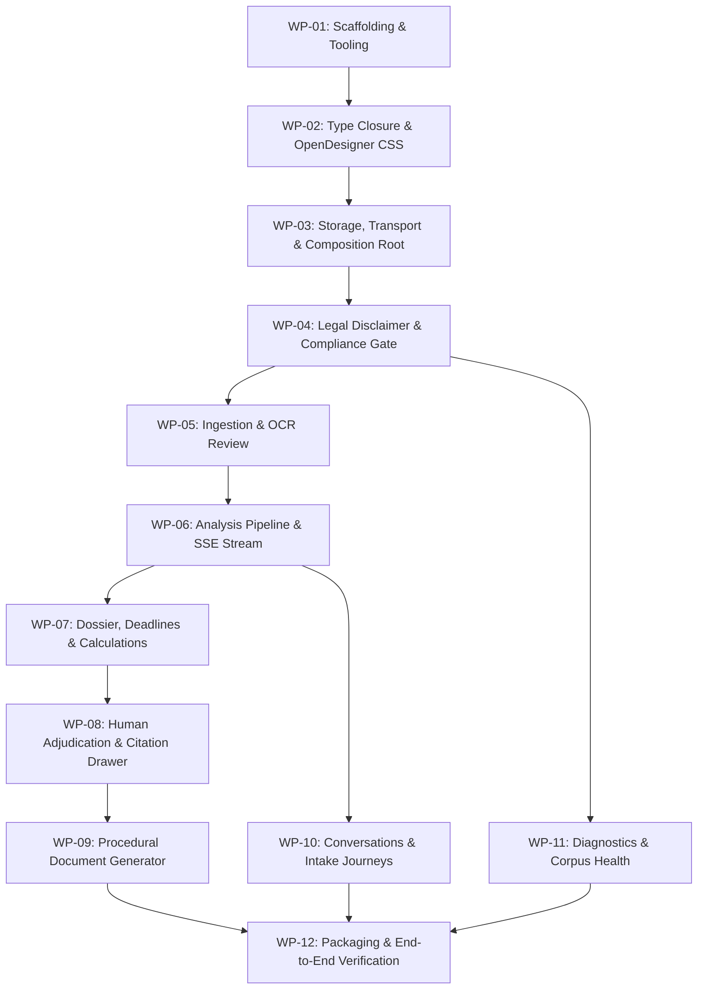
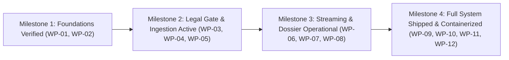

# Citizen-GUI — Implementation Roadmap (Doc 3)

- **Document Title:** Citizen-GUI Implementation Roadmap
- **Document Version:** `1.0.0`
- **Date:** 2026-11-16
- **Status:** Approved
- **Author:** Principal Systems Architect
- **Governing Architecture & Specifications:**
  - [Doc 1 v1.0.0 (System Architecture & Design Document)](file:///home/daniel/projects/citizen-gui/docs/01-DESIGN-DOCUMENT.md)
  - [Doc 2 v1.0.0 (Technical Specification)](file:///home/daniel/projects/citizen-gui/docs/02-TECHNICAL-SPEC.md)
- **Target Backend:** Citizen Backend `v2.0.0+` / REST & SSE API `/api/v1`

---

## Revision History

| Version | Date | Author | Description of Changes |
|---|---|---|---|
| `1.0.0` | 2026-11-16 | Principal Systems Architect | Initial formal Implementation Roadmap decomposing the system into 12 self-contained, sequentially executable Work Packages (WP-01 to WP-12). |

---

## 1. Roadmap Overview

### 1.1 Implementation Strategy
This roadmap decomposes Citizen-GUI into 12 granular, dependency-ordered Work Packages (WPs). The implementation strategy follows an inside-out, layered construction sequence:
1. **Phase 1: Foundations & Tooling (WP-01, WP-02):** Project scaffolding, dependency installation, strict TypeScript configuration, and OpenDesigner styling pipeline wiring.
2. **Phase 2: Core Transport & Singletons (WP-03, WP-04):** Storage adapters, resilient HTTP client with header interceptors, `@microsoft/fetch-event-source` streaming engine, Composition Root, and the legal disclaimer gate.
3. **Phase 3: Ingestion & Pipeline Streaming (WP-05, WP-06):** File upload dropzone, OCR quality assessment, side-by-side human text editor, and 11-stage SSE progress visualization.
4. **Phase 4: Dossier Presentation & Adjudication (WP-07, WP-08):** Statutory deadline banner, SGB II calculation cascade table, claim list with evidence binding badges, citation slide-over drawer, and human claim adjudication.
5. **Phase 5: Document Generation & Alternate Workflows (WP-09, WP-10):** *Widerspruch* document generator with unverified slot highlighting, multi-turn intake interview, and chat-first conversation journey.
6. **Phase 6: Diagnostics, Production Packaging & Verification (WP-11, WP-12):** System diagnostics (modules, corpus, goldset), multi-stage Docker build, Nginx reverse proxy configuration, and full end-to-end smoke verification.

### 1.2 Agent Consumption Model
- **Single-WP Execution:** An autonomous coding agent executes exactly one Work Package per session.
- **Strict Dependency Ordering:** No Work Package may be started until all of its dependencies have achieved their verified Definition of Done (DoD).
- **Zero Local Invention:** All code, interfaces, styles, and behaviors implemented in each WP must strictly reflect [Doc 1 v1.0.0](file:///home/daniel/projects/citizen-gui/docs/01-DESIGN-DOCUMENT.md) and [Doc 2 v1.0.0](file:///home/daniel/projects/citizen-gui/docs/02-TECHNICAL-SPEC.md). Any architectural gap discovered during execution triggers a versioned revision of Doc 2, never ad-hoc local invention.

---

## 2. Global Conventions

### 2.1 Repository Bootstrap Order
1. Install exact pinned dependencies using `npm ci`.
2. Validate TypeScript compilation using `npm run build` (`tsc -b`).
3. Run linting using `npm run lint`.
4. Execute Vitest test runner using `npm test`.

### 2.2 Branch & Commit Conventions
- Work branches: `feat/wp-<id>-<slug>` (e.g., `feat/wp-01-scaffolding`, `feat/wp-04-disclaimer-gate`).
- Commits follow Conventional Commits: `<type>(wp-<id>): <imperative summary>` (e.g., `feat(wp-01): bootstrap react 19 and vite configuration`).

### 2.3 Definition of Done (DoD) Applying to All WPs
A Work Package is considered complete if and only if all of the following conditions are met:
1. **Exact File Scope:** Only files listed in the WP's explicit scope are created or modified.
2. **Type Safety:** `npm run build` completes with zero TypeScript diagnostic errors under `strict: true`.
3. **Linting:** `npm run lint` completes with zero ESLint errors or warnings.
4. **Automated Verification:** All unit and integration tests defined for the WP pass with 100% success.
5. **Test Construction Rule Honored:** All tests establish pre-existing state by calling the production code path, never by direct fixture writes ([Doc 2 v1.0.0 §12.1](file:///home/daniel/projects/citizen-gui/docs/02-TECHNICAL-SPEC.md#121-mandatory-test-construction-rule)).
6. **OpenDesigner Review Clean:** Execution of `python3 .agents/skills/opendesigner/scripts/engine.py review` reports `Review: ok` with zero token bypasses or standard violations ([Doc 1 v1.0.0 §2.2 C-04](file:///home/daniel/projects/citizen-gui/docs/01-DESIGN-DOCUMENT.md#22-system-constraints-c--traceability-matrix)).

---

## 3. Dependency Graph



### Work Package Index & Parallelism

| WP ID | Title | Phase | Depends On | Parallelizable With |
|---|---|---|---|---|
| **WP-01** | Scaffolding & Tooling Setup | Phase 1 | *None* | *None* |
| **WP-02** | Type Definitions & OpenDesigner Styling Pipeline | Phase 1 | WP-01 | *None* |
| **WP-03** | Storage Adapters, Transport Layer & Composition Root | Phase 2 | WP-02 | *None* |
| **WP-04** | Legal Disclaimer Service & Compliance Modal Gate | Phase 2 | WP-03 | *None* |
| **WP-05** | Document Ingestion, File Dropzone & OCR Text Editor | Phase 3 | WP-04 | WP-11 |
| **WP-06** | Analysis Pipeline Service & SSE Streaming Timeline | Phase 3 | WP-05 | *None* |
| **WP-07** | Dossier Viewer, Statutory Deadlines & Calculation Cascade | Phase 4 | WP-06 | WP-10 |
| **WP-08** | Human Adjudication Interface & Citation Slide-Over Drawer | Phase 4 | WP-07 | *None* |
| **WP-09** | Procedural Document Generator & Unverified Slot Alerts | Phase 5 | WP-08 | *None* |
| **WP-10** | Conversations (Chat-First) & Multi-Turn Intake Wizards | Phase 5 | WP-06 | WP-07, WP-08, WP-09 |
| **WP-11** | Legal Module Catalog, Corpus Health & Goldset Viewer | Phase 6 | WP-04 | WP-05, WP-06, WP-07 |
| **WP-12** | Production Docker, Nginx Proxy & End-to-End Verification | Phase 6 | WP-09, WP-10, WP-11 | *None* |

---

## 4. Work Packages

### WP-01: Scaffolding & Tooling Setup
- **Phase:** Phase 1 (Foundations & Tooling)
- **Depends On:** *None*
- **Objective:** Initialize the repository with pinned dependencies, strict TypeScript settings, Vite build tooling, and Vitest test runner configuration.
- **Rationale:** Establishes the reproducible development environment and validation gates before any domain logic is written.
- **Scope:**
  - *Create:* `package.json`, `tsconfig.json`, `tsconfig.node.json`, `vite.config.ts`, `index.html`, `public/favicon.svg`, `tests/setup.ts`
  - *Out of Scope:* Application source files (`src/`).
- **Spec References:** [Doc 2 v1.0.0 §2](file:///home/daniel/projects/citizen-gui/docs/02-TECHNICAL-SPEC.md#2-project-structure), [§3](file:///home/daniel/projects/citizen-gui/docs/02-TECHNICAL-SPEC.md#3-dependencies), [§4.1](file:///home/daniel/projects/citizen-gui/docs/02-TECHNICAL-SPEC.md#41-typescript-configuration-tsconfigjson), [§4.2](file:///home/daniel/projects/citizen-gui/docs/02-TECHNICAL-SPEC.md#42-vite-configuration-viteconfigts).
- **Task List:**
  1. Create `package.json` with exact dependency versions specified in Doc 2 §3.
  2. Create `tsconfig.json` and `tsconfig.node.json` with strict mode and path alias `@/* -> src/*` per Doc 2 §4.1.
  3. Create `vite.config.ts` configured with `@vitejs/plugin-react`, `@tailwindcss/vite`, port 3000, and 540 s backend proxy per Doc 2 §4.2.
  4. Create `index.html` referencing `/src/main.tsx` with German lang tag (`<html lang="de">`).
  5. Create `tests/setup.ts` configuring `@testing-library/jest-dom` extensions.
  6. Execute `npm install` and verify zero vulnerability warnings.
- **Contracts Consumed / Produced:**
  - *Consumed:* Node.js 22+ runtime.
  - *Produced:* Working `npm run dev`, `npm run build`, and `npm test` toolchain.
- **Acceptance Criteria:**
  - `npm ci` completes successfully with zero peer dependency conflicts.
  - `npm run build` exits 0.
  - `npm test` executes Vitest and exits 0.
- **Verification Commands:**
  ```bash
  npm ci
  npm run build
  npm test
  ```
- **Sizing:** S (1 agent session, ~150 lines configuration).

---

### WP-02: Type Definitions & OpenDesigner Styling Pipeline
- **Phase:** Phase 1 (Foundations & Tooling)
- **Depends On:** WP-01
- **Objective:** Establish the closed domain type definitions and wire OpenDesigner's canonical CSS and Tailwind tokens into the build.
- **Rationale:** Guarantees complete type closure across all later modules and prevents any hardcoded styling literals or design drift.
- **Scope:**
  - *Create:* `src/types/api.ts`, `src/types/domain.ts`, `src/types/events.ts`, `src/index.css`
  - *Out of Scope:* Component implementations, UI views.
- **Spec References:** [Doc 1 v1.0.0 §2.2 C-04](file:///home/daniel/projects/citizen-gui/docs/01-DESIGN-DOCUMENT.md#22-system-constraints-c--traceability-matrix), [Doc 2 v1.0.0 §4.3](file:///home/daniel/projects/citizen-gui/docs/02-TECHNICAL-SPEC.md#43-styling-configuration), [§5](file:///home/daniel/projects/citizen-gui/docs/02-TECHNICAL-SPEC.md#5-data-layer--type-closure).
- **Task List:**
  1. Author `src/types/api.ts` containing all backend response schemas from Doc 2 §5.
  2. Author `src/types/domain.ts` containing client models (claims, cases, slots, generator options) from Doc 2 §5.
  3. Author `src/types/events.ts` containing the 11 SSE stage payloads, terminal payloads, and error schemas from Doc 2 §5.
  4. Author `src/index.css` importing `@tailwindcss`, `opendesigner/build/css/tokens.css`, and `opendesigner/build/tailwind/theme.css` with accessibility overrides (focus ring 2 px, prefers-reduced-motion) per Doc 2 §4.3.
  5. Author unit test `tests/unit/types-and-styles.test.ts` verifying all types export cleanly and CSS variables resolve.
- **Contracts Consumed / Produced:**
  - *Consumed:* `opendesigner/build/css/tokens.css`, `opendesigner/build/tailwind/theme.css`.
  - *Produced:* Exported domain types in `@/types/*` and global utility styles in `@/index.css`.
- **Acceptance Criteria:**
  - All 18 interfaces and 3 type unions from Doc 2 §5 compile without diagnostic errors.
  - No undefined types remain; type closure is 100%.
  - `python3 .agents/skills/opendesigner/scripts/engine.py review` verifies CSS tokens are cleanly mapped.
- **Verification Commands:**
  ```bash
  npx tsc --noEmit
  npm test tests/unit/types-and-styles.test.ts
  ```
- **Sizing:** S (1 agent session, ~350 lines).

---

### WP-03: Storage Adapters, Transport Layer & Composition Root
- **Phase:** Phase 2 (Core Transport & Singletons)
- **Depends On:** WP-02
- **Objective:** Implement the `localStorage` preferences store, DOMPurify HTML sanitizer, resilient HTTP client, `@microsoft/fetch-event-source` streaming wrapper, and initialize the central Composition Root.
- **Rationale:** Establishes the infrastructure singleton root, header injection mechanics, and XSS sanitization required by all subsequent services.
- **Scope:**
  - *Create:* `src/stores/localPreferences.ts`, `src/services/http.ts`, `src/services/sse.ts`, `src/components/common/SanitizedHtml.tsx`, `src/compositionRoot.ts`, `tests/unit/sanitization.test.ts`, `tests/unit/stores.test.ts`
  - *Out of Scope:* Domain services, UI pages.
- **Spec References:** [Doc 1 v1.0.0 §2.2 C-01, C-03, C-07](file:///home/daniel/projects/citizen-gui/docs/01-DESIGN-DOCUMENT.md#22-system-constraints-c--traceability-matrix), [Doc 2 v1.0.0 §5.2](file:///home/daniel/projects/citizen-gui/docs/02-TECHNICAL-SPEC.md#52-client-side-storage-schema-localstorage), [§7](file:///home/daniel/projects/citizen-gui/docs/02-TECHNICAL-SPEC.md#7-authentication--authorization-authnauthz), [§8.1](file:///home/daniel/projects/citizen-gui/docs/02-TECHNICAL-SPEC.md#81-module-http-http-transport-client), [§8.2](file:///home/daniel/projects/citizen-gui/docs/02-TECHNICAL-SPEC.md#82-module-sse-streaming-transport-client), [§15.1](file:///home/daniel/projects/citizen-gui/docs/02-TECHNICAL-SPEC.md#151-composition-root).
- **Task List:**
  1. Implement `LocalPreferencesStore` adhering strictly to the 4 storage keys defined in Doc 1 §5.2.
  2. Implement `SanitizedHtml.tsx` wrapping `DOMPurify.sanitize()` to enforce **[C-07]**.
  3. Implement `HttpClient` in `src/services/http.ts` automatically appending `X-Disclaimer-Ack` and dev-mode `X-Document-Tag` headers.
  4. Implement `SseClient` in `src/services/sse.ts` wrapping `@microsoft/fetch-event-source` with 60 s watchdog timer.
  5. Implement `CompositionRoot` in `src/compositionRoot.ts` assembling singletons per Doc 2 §15.1.
  6. Author unit tests verifying DOMPurify strips malicious scripts/handlers and verifying `LocalPreferencesStore` correctly reads/writes keys.
- **Contracts Consumed / Produced:**
  - *Consumed:* `@/types/api`, `@/types/events`.
  - *Produced:* `CompositionRoot.prefs`, `CompositionRoot.http`, `CompositionRoot.sse`, `<SanitizedHtml />`.
- **Acceptance Criteria:**
  - `SanitizedHtml` removes `<script>`, `onerror=`, and `javascript:` URIs from input strings.
  - `HttpClient` automatically attaches `X-Disclaimer-Ack` header when present in preferences store.
  - `CompositionRoot` is the sole instantiator of HTTP and SSE transport instances.
- **Verification Commands:**
  ```bash
  npm test tests/unit/sanitization.test.ts tests/unit/stores.test.ts
  ```
- **Sizing:** M (1 agent session, ~400 lines).

---

### WP-04: Legal Disclaimer Service & Compliance Modal Gate
- **Phase:** Phase 2 (Core Transport & Singletons)
- **Depends On:** WP-03
- **Objective:** Implement the legal disclaimer handshake service, Art. 50 disclosure validator, and the un-dismissible disclaimer modal gate blocking unauthorized route access.
- **Rationale:** Satisfies regulatory requirements under EU AI Act Art. 50 and enforces the mandatory Citizen backend disclaimer handshake before allowing any analysis actions.
- **Scope:**
  - *Create:* `src/services/disclaimer.ts`, `src/stores/complianceStore.ts`, `src/components/layout/DisclaimerModal.tsx`, `src/components/layout/Navbar.tsx`, `src/components/layout/SystemStatusBanner.tsx`, `src/App.tsx`, `tests/unit/disclaimer.test.ts`
  - *Out of Scope:* Ingestion and dossier views.
- **Spec References:** [Doc 1 v1.0.0 §2.1 FR-01, FR-02](file:///home/daniel/projects/citizen-gui/docs/01-DESIGN-DOCUMENT.md#21-functional-requirements-fr), [Doc 2 v1.0.0 §7](file:///home/daniel/projects/citizen-gui/docs/02-TECHNICAL-SPEC.md#7-authentication--authorization-authnauthz), [§8.3](file:///home/daniel/projects/citizen-gui/docs/02-TECHNICAL-SPEC.md#83-module-disclaimer-compliance-service), [§15.3 Call Trace 1](file:///home/daniel/projects/citizen-gui/docs/02-TECHNICAL-SPEC.md#call-trace-1-application-bootstrap--disclaimer-handshake).
- **Task List:**
  1. Implement `DisclaimerService` with `checkVersion()`, `fetchDisclaimerText()`, `acknowledge()`, and `fetchDisclosure()`.
  2. Implement `complianceStore` managing `isDisclaimerModalOpen` and Art. 50 presentation state.
  3. Implement `DisclaimerModal.tsx` rendering sanitized German legal notice with an explicit "Zustimmen" confirmation button.
  4. Implement `Navbar.tsx` and `SystemStatusBanner.tsx` displaying backend liveness and dev-mode warnings.
  5. Assemble top-level `App.tsx` executing Call Trace 1 on mount: halts UI and opens `DisclaimerModal` if stored version !== backend version.
  6. Author unit test `tests/unit/disclaimer.test.ts` verifying unconfirmed boot triggers modal, and clicking confirm persists version and closes modal.
- **Contracts Consumed / Produced:**
  - *Consumed:* `CompositionRoot.http`, `CompositionRoot.prefs`.
  - *Produced:* `CompositionRoot.disclaimer`, `<DisclaimerModal />`, `<App />`.
- **Acceptance Criteria:**
  - Starting with empty `localStorage`, the app opens `DisclaimerModal` displaying text from `/api/v1/meta/disclaimer/text`.
  - Clicking "Zustimmen" sets `citizen_disclaimer_ack_version` to backend version and unlocks navigation.
  - A simulated `403 disclaimer_version_mismatch` clears stored ack and immediately re-opens the modal.
- **Verification Commands:**
  ```bash
  npm test tests/unit/disclaimer.test.ts
  ```
- **Sizing:** M (1 agent session, ~420 lines).

---

### WP-05: Document Ingestion, File Dropzone & OCR Text Editor
- **Phase:** Phase 3 (Ingestion & Pipeline Streaming)
- **Depends On:** WP-04
- **Objective:** Implement file upload drag-and-drop, OCR quality assessment evaluation, and the side-by-side human inspection and correction editor.
- **Rationale:** Ensures notices are parsed locally, evaluated for readability, and explicitly confirmed by the citizen prior to any LLM pipeline execution.
- **Scope:**
  - *Create:* `src/services/ingestion.ts`, `src/components/ingestion/Dropzone.tsx`, `src/components/ingestion/OcrQualityBadge.tsx`, `src/components/ingestion/TextCorrectionEditor.tsx`, `tests/integration/ingestion.test.ts`
  - *Out of Scope:* Pipeline analysis triggering.
- **Spec References:** [Doc 1 v1.0.0 §2.1 FR-03](file:///home/daniel/projects/citizen-gui/docs/01-DESIGN-DOCUMENT.md#21-functional-requirements-fr), [Doc 2 v1.0.0 §8.4](file:///home/daniel/projects/citizen-gui/docs/02-TECHNICAL-SPEC.md#84-module-ingestion-document-ingestion-service), [§15.3 Call Trace 2](file:///home/daniel/projects/citizen-gui/docs/02-TECHNICAL-SPEC.md#call-trace-2-document-ingestion-ocr-verification--human-confirmation).
- **Task List:**
  1. Implement `IngestionService` executing `uploadDocument()` (`POST /api/v1/ingest`) and `assessQuality()` (`GET /api/v1/ocr/assess`).
  2. Implement `Dropzone.tsx` with drag-and-drop support for PDF, JPG, PNG, TXT, HTML, EML and client-side 25 MB ceiling check.
  3. Implement `OcrQualityBadge.tsx` displaying score, level (`good`/`medium`/`poor`), and detected warnings.
  4. Implement `TextCorrectionEditor.tsx` providing an accessible full-height textarea with character count and a prominent "Text bestätigen & Fortfahren" action.
  5. Author integration test `tests/integration/ingestion.test.ts` using MSW to simulate PDF upload, OCR scoring, user text editing, and confirmation.
- **Contracts Consumed / Produced:**
  - *Consumed:* `CompositionRoot.http`, `CompositionRoot.prefs`.
  - *Produced:* `CompositionRoot.ingestion`, `<Dropzone />`, `<TextCorrectionEditor />`.
- **Acceptance Criteria:**
  - Files > 25 MB are rejected immediately on the client with an accessible German error message.
  - Successfully uploaded documents render their extracted text inside `TextCorrectionEditor`.
  - User can modify the extracted text; clicking "Text bestätigen" produces confirmed string for pipeline consumption.
- **Verification Commands:**
  ```bash
  npm test tests/integration/ingestion.test.ts
  ```
- **Sizing:** M (1 agent session, ~450 lines).

---

### WP-06: Analysis Pipeline Service & SSE Streaming Timeline
- **Phase:** Phase 3 (Ingestion & Pipeline Streaming)
- **Depends On:** WP-05
- **Objective:** Implement the pipeline execution service, reactive streaming store, stage progress timeline, and live token streamer.
- **Rationale:** Connects confirmed document text to Citizen's 11-stage analysis engine, providing real-time visual feedback across the 8-minute pipeline budget.
- **Scope:**
  - *Create:* `src/services/analysis.ts`, `src/stores/streamingStore.ts`, `src/components/pipeline/StageTimeline.tsx`, `src/components/pipeline/LiveTokenStream.tsx`, `src/components/pipeline/StageErrorAlert.tsx`, `tests/integration/pipeline-stream.test.ts`
  - *Out of Scope:* Dossier view rendering.
- **Spec References:** [Doc 1 v1.0.0 §2.1 FR-04](file:///home/daniel/projects/citizen-gui/docs/01-DESIGN-DOCUMENT.md#21-functional-requirements-fr), [Doc 2 v1.0.0 §8.5](file:///home/daniel/projects/citizen-gui/docs/02-TECHNICAL-SPEC.md#85-module-analysis-analysis-pipeline-service), [§15.3 Call Trace 3](file:///home/daniel/projects/citizen-gui/docs/02-TECHNICAL-SPEC.md#call-trace-3-analysis-pipeline-execution--sse-stream-consumption).
- **Task List:**
  1. Implement `streamingStore` modeling pipeline state (`idle`, `connecting`, active stage, stage durations, tokens, terminal payload, error).
  2. Implement `AnalysisService` dispatching `POST /api/v1/analyze` via `SseClient` with stage callbacks.
  3. Implement `StageTimeline.tsx` visually displaying all 11 stages (`corpus_health` through `calculation_check`) with running/completed badges and elapsed timers.
  4. Implement `LiveTokenStream.tsx` rendering incremental tokens during the `construction` stage.
  5. Implement `StageErrorAlert.tsx` catching stream error payloads (`pipeline_failed`) and rendering recovery instructions.
  6. Author integration test `tests/integration/pipeline-stream.test.ts` simulating a full 11-stage SSE stream via MSW and verifying timeline advancement and final state resolution.
- **Contracts Consumed / Produced:**
  - *Consumed:* `CompositionRoot.sse`, `@/types/events`.
  - *Produced:* `CompositionRoot.analysis`, `streamingStore`, `<StageTimeline />`.
- **Acceptance Criteria:**
  - Starting analysis transitions `streamingStore` into streaming mode and opens the SSE connection.
  - Stage events update timeline indicators sequentially in real time.
  - Receiving the final event commits the `AnalysisFinalEventPayload` and triggers completion callback.
- **Verification Commands:**
  ```bash
  npm test tests/integration/pipeline-stream.test.ts
  ```
- **Sizing:** M (1 agent session, ~480 lines).

---

### WP-07: Dossier Viewer, Statutory Deadlines & Calculation Cascade
- **Phase:** Phase 4 (Dossier Presentation & Adjudication)
- **Depends On:** WP-06
- **Objective:** Implement the primary case dossier view, rendering the legal deadline banner, the § 11b SGB II calculation comparison cascade, and atomic claims list.
- **Rationale:** Presents the core evidence-based findings answering "Was steht da drin?", "Stimmt das?", and "Bis wann muss ich reagieren?" with absolute statutory fidelity.
- **Scope:**
  - *Create:* `src/components/dossier/DeadlineBanner.tsx`, `src/components/dossier/CalculationTable.tsx`, `src/components/dossier/ClaimCard.tsx`, `src/components/dossier/AdversarialReviewCard.tsx`, `src/views/AnalyzeView.tsx`, `src/views/CaseDetailView.tsx`, `tests/integration/dossier-view.test.ts`
  - *Out of Scope:* Human adjudication mutations and document generator wizard.
- **Spec References:** [Doc 1 v1.0.0 §2.1 FR-05](file:///home/daniel/projects/citizen-gui/docs/01-DESIGN-DOCUMENT.md#21-functional-requirements-fr), [Doc 2 v1.0.0 §5.1](file:///home/daniel/projects/citizen-gui/docs/02-TECHNICAL-SPEC.md#5-data-layer--type-closure), [§8.6](file:///home/daniel/projects/citizen-gui/docs/02-TECHNICAL-SPEC.md#86-module-cases-case--adjudication-service), [§14 AC-05](file:///home/daniel/projects/citizen-gui/docs/02-TECHNICAL-SPEC.md#14-acceptance-criteria).
- **Task List:**
  1. Implement `DeadlineBanner.tsx` displaying calculated deadline date, delivery fiction notice (§ 37 Abs. 2 SGB X), and holiday rollover (§ 64 Abs. 3 SGG).
  2. Implement `CalculationTable.tsx` displaying the cent-precise comparison between Jobcenter computation and correct statutory entitlement.
  3. Implement `ClaimCard.tsx` rendering atomic claims with confidence score and `verified` / `unverified` status badges.
  4. Implement `AdversarialReviewCard.tsx` rendering the multi-perspective legal analysis (defense, authority, court).
  5. Implement `AnalyzeView.tsx` tying together Dropzone -> Editor -> Stream -> Dossier.
  6. Author integration test `tests/integration/dossier-view.test.ts` verifying all calculations and deadlines render without rounding or formatting errors.
- **Contracts Consumed / Produced:**
  - *Consumed:* `AnalysisFinalEventPayload`, `CaseDetail`.
  - *Produced:* `<DeadlineBanner />`, `<CalculationTable />`, `<ClaimCard />`, `<AnalyzeView />`.
- **Acceptance Criteria:**
  - Deadlines display statutory basis (§ 84 SGG / § 66 Abs. 2 SGG) and clear date formatting.
  - Calculation discrepancies are highlighted in red (negative) or green (positive) with exact cent amounts.
  - Art. 50 disclosure notification and provenance badge are rendered prominently above dossier findings.
- **Verification Commands:**
  ```bash
  npm test tests/integration/dossier-view.test.ts
  ```
- **Sizing:** L (1 agent session, ~500 lines).

---

### WP-08: Human Adjudication Interface & Citation Slide-Over Drawer
- **Phase:** Phase 4 (Dossier Presentation & Adjudication)
- **Depends On:** WP-07
- **Objective:** Implement interactive Agree/Dispute controls on claims and sections, inline claim text editing, single-stage re-evaluation, and the citation slide-over drawer.
- **Rationale:** Empowers the citizen or advocate to adjudicate findings, inspect original law texts, and steer the dossier before generating action documents.
- **Scope:**
  - *Create:* `src/services/cases.ts`, `src/components/dossier/EvidenceCitationDrawer.tsx`, `src/views/CaseArchiveView.tsx`, `tests/integration/adjudication.test.ts`
  - *Modify:* `src/components/dossier/ClaimCard.tsx` (add adjudication buttons)
  - *Out of Scope:* Letter generation.
- **Spec References:** [Doc 1 v1.0.0 §2.1 FR-06, FR-08](file:///home/daniel/projects/citizen-gui/docs/01-DESIGN-DOCUMENT.md#21-functional-requirements-fr), [Doc 2 v1.0.0 §8.6](file:///home/daniel/projects/citizen-gui/docs/02-TECHNICAL-SPEC.md#86-module-cases-case--adjudication-service), [§15.3 Call Trace 4](file:///home/daniel/projects/citizen-gui/docs/02-TECHNICAL-SPEC.md#call-trace-4-dossier-review--human-claim-adjudication).
- **Task List:**
  1. Implement `CasesService` in `src/services/cases.ts` with `listRecentCases()`, `getCase()`, `deleteCase()`, `adjudicate()`, and `patchClaim()`.
  2. Implement `EvidenceCitationDrawer.tsx` rendering exact statutory paragraph, source authority, and chunk quotation upon citation click.
  3. Update `ClaimCard.tsx` with Agree ("Zustimmen") and Dispute ("Widersprechen") actions dispatching Call Trace 4.
  4. Implement `CaseArchiveView.tsx` listing the 100 most recent cases with status badges and deletion triggers.
  5. Author integration test `tests/integration/adjudication.test.ts` verifying that clicking "Zustimmen" calls `POST /api/v1/cases/{id}/adjudicate` and updates claim badge state.
- **Contracts Consumed / Produced:**
  - *Consumed:* `CompositionRoot.http`, `@/types/domain`.
  - *Produced:* `CompositionRoot.cases`, `<EvidenceCitationDrawer />`, `<CaseArchiveView />`.
- **Acceptance Criteria:**
  - Clicking a citation opens the slide-over drawer displaying source text chunks without navigating away.
  - Toggling adjudication updates claim UI optimistically and persists status to Citizen backend.
  - Deleting a case removes it from `CaseArchiveView`.
- **Verification Commands:**
  ```bash
  npm test tests/integration/adjudication.test.ts
  ```
- **Sizing:** M (1 agent session, ~450 lines).

---

### WP-09: Procedural Document Generator & Unverified Slot Alerts
- **Phase:** Phase 5 (Document Generation & Alternate Workflows)
- **Depends On:** WP-08
- **Objective:** Implement the procedural draft generator form for *Widerspruch*, *Überprüfungsantrag § 44 SGB X*, and *Akteneinsichtsantrag § 25 SGB X*, featuring local user slot population and unverified slot alerts.
- **Rationale:** Answers "Was mache ich jetzt?" by producing ready-to-sign legal drafts grounded in confirmed findings while warning citizens of any unverified claims.
- **Scope:**
  - *Create:* `src/services/documents.ts`, `src/components/documents/DocumentGeneratorForm.tsx`, `src/components/documents/UnverifiedSlotAlert.tsx`, `src/components/documents/DocumentPreview.tsx`, `tests/integration/document-generator.test.ts`
  - *Out of Scope:* Chat-first workflows.
- **Spec References:** [Doc 1 v1.0.0 §2.1 FR-07](file:///home/daniel/projects/citizen-gui/docs/01-DESIGN-DOCUMENT.md#21-functional-requirements-fr), [Doc 2 v1.0.0 §8.7](file:///home/daniel/projects/citizen-gui/docs/02-TECHNICAL-SPEC.md#87-module-documents-procedural-draft-service), [§15.3 Call Trace 5](file:///home/daniel/projects/citizen-gui/docs/02-TECHNICAL-SPEC.md#call-trace-5-procedural-document-generation-widerspruch).
- **Task List:**
  1. Implement `DocumentService` in `src/services/documents.ts` with `getOptions()` and `generate()`.
  2. Implement `DocumentGeneratorForm.tsx` presenting template selector and personal details inputs (Name, Address, Aktenzeichen).
  3. Implement `UnverifiedSlotAlert.tsx` detecting `[BITTE PRÜFEN]` slots and rendering an amber warning card.
  4. Implement `DocumentPreview.tsx` rendering sanitized draft text with clipboard copy and printable view.
  5. Author integration test `tests/integration/document-generator.test.ts` verifying Call Trace 5: options fetch -> user details entry -> draft generation with slot verification badges.
- **Contracts Consumed / Produced:**
  - *Consumed:* `CompositionRoot.http`, `@/types/domain`.
  - *Produced:* `CompositionRoot.documents`, `<DocumentGeneratorForm />`, `<DocumentPreview />`.
- **Acceptance Criteria:**
  - Personal details entered by citizen are injected into the generated draft.
  - Any slot marked `needs_review: true` or containing `[BITTE PRÜFEN]` displays an explicit warning.
  - Draft carries `citizen-provenance-v1.1` footer metadata.
- **Verification Commands:**
  ```bash
  npm test tests/integration/document-generator.test.ts
  ```
- **Sizing:** M (1 agent session, ~420 lines).

---

### WP-10: Conversations (Chat-First) & Multi-Turn Intake Wizards
- **Phase:** Phase 5 (Document Generation & Alternate Workflows)
- **Depends On:** WP-06
- **Objective:** Implement the chat-first conversation interface with document attachment support, and the multi-turn intake interview wizard.
- **Rationale:** Accommodates users who prefer conversational exploration before formal document generation or require guided pre-analysis questioning.
- **Scope:**
  - *Create:* `src/services/conversations.ts`, `src/services/intake.ts`, `src/components/conversations/ChatWindow.tsx`, `src/components/conversations/DocumentAttachmentList.tsx`, `src/components/intake/IntakeWizard.tsx`, `src/components/intake/TurnCounter.tsx`, `src/views/ConversationView.tsx`, `src/views/IntakeView.tsx`, `tests/integration/conversations-and-intake.test.ts`
  - *Out of Scope:* Diagnostics and packaging.
- **Spec References:** [Doc 1 v1.0.0 §2.1 FR-09](file:///home/daniel/projects/citizen-gui/docs/01-DESIGN-DOCUMENT.md#21-functional-requirements-fr), [Doc 2 v1.0.0 §6.2](file:///home/daniel/projects/citizen-gui/docs/02-TECHNICAL-SPEC.md#62-endpoint-reference-matrix).
- **Task List:**
  1. Implement `ConversationService` managing conversation lifecycle, document attachments, and SSE message streaming.
  2. Implement `IntakeService` handling `start()`, `message()`, `restart()`, and `confirm()`.
  3. Implement `ChatWindow.tsx` and `DocumentAttachmentList.tsx` supporting document drops and streaming responses.
  4. Implement `IntakeWizard.tsx` and `TurnCounter.tsx` tracking turns (2–12) and yielding `IntakeResult`.
  5. Author integration test `tests/integration/conversations-and-intake.test.ts` verifying conversation creation, message streaming, and intake turn handling.
- **Contracts Consumed / Produced:**
  - *Consumed:* `CompositionRoot.http`, `CompositionRoot.sse`.
  - *Produced:* `CompositionRoot.conversations`, `CompositionRoot.intake`, `<ConversationView />`, `<IntakeView />`.
- **Acceptance Criteria:**
  - First message with attached document executes full analysis pipeline; subsequent messages perform grounded RAG chat.
  - Intake wizard tracks turn count accurately and returns structured `IntakeResult` upon completion.
- **Verification Commands:**
  ```bash
  npm test tests/integration/conversations-and-intake.test.ts
  ```
- **Sizing:** M (1 agent session, ~460 lines).

---

### WP-11: Legal Module Catalog, Corpus Health & Goldset Viewer
- **Phase:** Phase 6 (Diagnostics, Packaging & Verification)
- **Depends On:** WP-04
- **Objective:** Implement the secondary diagnostic view displaying installed legal modules, corpus health monitor with background update polling, and the goldset eval report viewer.
- **Rationale:** Exposes system transparency, legal area readiness, and verification goldsets for legal researchers, developers, and system operators without cluttering the primary citizen journey.
- **Scope:**
  - *Create:* `src/services/diagnostics.ts`, `src/components/diagnostics/ModuleCatalogTable.tsx`, `src/components/diagnostics/CorpusHealthMonitor.tsx`, `src/components/diagnostics/GoldsetReportViewer.tsx`, `src/views/DiagnosticsView.tsx`, `tests/integration/diagnostics.test.ts`
  - *Out of Scope:* Production container packaging.
- **Spec References:** [Doc 1 v1.0.0 §2.1 FR-10](file:///home/daniel/projects/citizen-gui/docs/01-DESIGN-DOCUMENT.md#21-functional-requirements-fr), [Doc 2 v1.0.0 §8.8](file:///home/daniel/projects/citizen-gui/docs/02-TECHNICAL-SPEC.md#8-module-specifications), [§9 Background Jobs](file:///home/daniel/projects/citizen-gui/docs/02-TECHNICAL-SPEC.md#9-background-jobs).
- **Task List:**
  1. Implement `DiagnosticsService` with `getModules()`, `getCorpusHealth()`, `triggerCorpusUpdate()`, `pollCorpusJob()`, `getGoldsets()`, and `getEvalReports()`.
  2. Implement `ModuleCatalogTable.tsx` listing legal areas, module tiers (`verified` vs `experimental`), and corpus readiness flags.
  3. Implement `CorpusHealthMonitor.tsx` with chunk counts and a 3-second polling worker for update jobs per Doc 2 §9.
  4. Implement `GoldsetReportViewer.tsx` displaying evaluation metrics (issue recall, citation precision, zero regression gates).
  5. Author integration test `tests/integration/diagnostics.test.ts` verifying corpus update trigger initiates polling and terminates upon completion.
- **Contracts Consumed / Produced:**
  - *Consumed:* `CompositionRoot.http`.
  - *Produced:* `CompositionRoot.diagnostics`, `<DiagnosticsView />`.
  - **Acceptance Criteria:**
  - Modules table correctly reflects `enabled: true/false` and corpus readiness.
  - Triggering corpus update starts polling interval and updates progress counters until completed.
  - Goldset reports display precision/recall metrics cleanly.
- **Verification Commands:**
  ```bash
  npm test tests/integration/diagnostics.test.ts
  ```
- **Sizing:** M (1 agent session, ~440 lines).

---

### WP-12: Production Docker, Nginx Proxy & End-to-End Verification
- **Phase:** Phase 6 (Diagnostics, Packaging & Verification)
- **Depends On:** WP-09, WP-10, WP-11
- **Objective:** Author production multi-stage `Dockerfile`, production `nginx.conf` with 540 s unbuffered SSE proxying, and execute full end-to-end smoke tests against mock backend.
- **Rationale:** Packages Citizen-GUI for sovereign local and containerized deployments alongside Citizen's Docker Compose stack.
- **Scope:**
  - *Create:* `Dockerfile`, `nginx.conf`, `tests/e2e/smoke.test.ts`
  - *Out of Scope:* Backend engine modifications.
- **Spec References:** [Doc 1 v1.0.0 §8](file:///home/daniel/projects/citizen-gui/docs/01-DESIGN-DOCUMENT.md#8-infrastructure--deployment), [Doc 2 v1.0.0 §13.2](file:///home/daniel/projects/citizen-gui/docs/02-TECHNICAL-SPEC.md#132-containerized-production-deployment), [§14 Acceptance Criteria](file:///home/daniel/projects/citizen-gui/docs/02-TECHNICAL-SPEC.md#14-acceptance-criteria).
- **Task List:**
  1. Create multi-stage `Dockerfile` (Node 22 build -> Nginx unprivileged Alpine runtime) per Doc 1 §8.1.
  2. Create production `nginx.conf` with SPA routing (`try_files`), 540 s proxy timeouts, `proxy_buffering off`, and strict CSP headers per Doc 1 §8.2.
  3. Author comprehensive end-to-end smoke test `tests/e2e/smoke.test.ts` exercising Call Traces 1 through 5 sequentially.
  4. Execute full container build: `docker build -t citizen-gui:1.0.0 .`.
  5. Run test container and verify that `GET /` serves HTML and `GET /api/health` proxies to upstream backend.
- **Contracts Consumed / Produced:**
  - *Consumed:* Entire `src/` codebase, Doc 1 §8 configurations.
  - *Produced:* Deployable Docker image `citizen-gui:1.0.0`.
- **Acceptance Criteria:**
  - `docker build` succeeds producing a lightweight Alpine image (< 50 MB compressed).
  - Nginx configuration passes `nginx -t` test.
  - Full smoke test suite executes with zero failures.
- **Verification Commands:**
  ```bash
  npm run build
  npm test tests/e2e/smoke.test.ts
  docker build -t citizen-gui:1.0.0 .
  ```
- **Sizing:** M (1 agent session, ~250 lines).

---

## 5. Milestones & Integration Checkpoints



### Milestone 1: Foundations Verified (after WP-02)
- **Goal:** Clean build, closed type system, and functional OpenDesigner CSS token pipeline.
- **Smoke-Test Procedure:**
  1. Execute `npm ci && npm run build`.
  2. Verify output dist directory is generated without TypeScript warnings.
  3. Verify `opendesigner/build/css/tokens.css` values resolve cleanly in CSS inspector.

### Milestone 2: Legal Gate & Ingestion Active (after WP-05)
- **Goal:** Unconfirmed users are blocked by the disclaimer modal; uploading a notice extracts text and displays OCR quality scores.
- **Smoke-Test Procedure:**
  1. Clear browser `localStorage` and navigate to `http://localhost:3000`.
  2. Verify `DisclaimerModal` renders and cannot be dismissed without clicking "Zustimmen".
  3. Drop a synthetic PDF notice into `Dropzone`. Verify extracted text appears in `TextCorrectionEditor` alongside OCR score badge.

### Milestone 3: Streaming & Dossier Operational (after WP-08)
- **Goal:** Analysis pipeline consumes all 11 stages in real time and renders complete Dossier with statutory deadlines, calculation tables, and citation drawer.
- **Smoke-Test Procedure:**
  1. Click "Analyse starten" with confirmed text.
  2. Observe `StageTimeline` advancing through all 11 stages with live streaming tokens in construction stage.
  3. Confirm transition to `DossierView`: Verify Fristen banner, SGB II calculation comparison, and atomic claim cards.
  4. Click citation link: Verify `EvidenceCitationDrawer` slides open showing statutory text chunk.
  5. Click "Zustimmen" on a claim: Verify badge updates to "Bestätigt".

### Milestone 4: Full System Shipped & Containerized (after WP-12)
- **Goal:** Complete end-to-end journey from Ingestion to *Widerspruch* document generation, verified inside production Docker container.
- **Smoke-Test Procedure:**
  1. Build and run production container: `docker run -p 3000:3000 citizen-gui:1.0.0`.
  2. Execute complete user journey: Ingest -> OCR confirm -> SSE stream -> Adjudicate -> Generate Widerspruch.
  3. Verify unverified slots display `[BITTE PRÜFEN]` warning.
  4. Download Markdown and verify Art. 50(2) provenance footer is present.

---

## 6. Coverage & Traceability Matrix

Every requirement, constraint, and module from [Doc 1 v1.0.0](file:///home/daniel/projects/citizen-gui/docs/01-DESIGN-DOCUMENT.md) and [Doc 2 v1.0.0](file:///home/daniel/projects/citizen-gui/docs/02-TECHNICAL-SPEC.md) is mapped to its implementing Work Package below:

| Requirement / Spec Item | Governing Section | Implementing Work Package(s) | Verification Check |
|---|---|---|---|
| **C-01 (Stateless GUI)** | Doc 1 §2.2 | WP-03 | `tests/unit/stores.test.ts` validates localStorage key boundaries. |
| **C-02 (No Auth Model)** | Doc 1 §2.2 | WP-04, WP-12 | Reverse-proxy pass-through verified in Nginx tests. |
| **C-03 (540s Timeout)** | Doc 1 §2.2 | WP-01, WP-03, WP-12 | Timeout settings verified in Vite and Nginx configs. |
| **C-04 (Design Strictness)**| Doc 1 §2.2 | WP-02, WP-07 | `engine.py review` clean, zero styling literals. |
| **C-05 (Deterministic Engine)**| Doc 1 §2.2 | WP-07 | Calculation view renders backend values without client math. |
| **C-06 (Dev-Mode Tagging)** | Doc 1 §2.2 | WP-03, WP-05 | Ingestion service appends `X-Document-Tag: synthetic` in dev. |
| **C-07 (Sanitization)** | Doc 1 §2.2 | WP-03, WP-04, WP-09 | `tests/unit/sanitization.test.ts` verifies script stripping. |
| **FR-01 (Disclaimer Gate)** | Doc 1 §2.1 | WP-04 | `tests/unit/disclaimer.test.ts` validates modal blocking. |
| **FR-02 (EU AI Act Art. 50)**| Doc 1 §2.1 | WP-04, WP-07 | Pre-result disclosure gate and provenance banner verified. |
| **FR-03 (Ingestion & OCR)** | Doc 1 §2.1 | WP-05 | `tests/integration/ingestion.test.ts` passes. |
| **FR-04 (SSE Pipeline)** | Doc 1 §2.1 | WP-06 | `tests/integration/pipeline-stream.test.ts` passes. |
| **FR-05 (Dossier & Deadlines)**| Doc 1 §2.1 | WP-07 | `tests/integration/dossier-view.test.ts` passes. |
| **FR-06 (Adjudication)** | Doc 1 §2.1 | WP-08 | `tests/integration/adjudication.test.ts` passes. |
| **FR-07 (Document Gen)** | Doc 1 §2.1 | WP-09 | `tests/integration/document-generator.test.ts` passes. |
| **FR-08 (Case Archive)** | Doc 1 §2.1 | WP-08 | Case listing and deletion verified in archive view. |
| **FR-09 (Chat & Intake)** | Doc 1 §2.1 | WP-10 | `tests/integration/conversations-and-intake.test.ts` passes. |
| **FR-10 (Diagnostics)** | Doc 1 §2.1 | WP-11 | `tests/integration/diagnostics.test.ts` passes. |
| **Module: http** | Doc 2 §8.1 | WP-03 | Request/upload with header interceptors verified. |
| **Module: sse** | Doc 2 §8.2 | WP-03, WP-06 | EventSource wrapper with 60 s watchdog verified. |
| **Module: disclaimer** | Doc 2 §8.3 | WP-04 | Version check and acknowledgement verified. |
| **Module: ingestion** | Doc 2 §8.4 | WP-05 | File upload and OCR scoring verified. |
| **Module: analysis** | Doc 2 §8.5 | WP-06 | Pipeline execution and re-eval verified. |
| **Module: cases** | Doc 2 §8.6 | WP-08 | Case listing, detail, and adjudication verified. |
| **Module: documents** | Doc 2 §8.7 | WP-09 | Option retrieval and letter generation verified. |
| **Composition Root** | Doc 2 §15.1 | WP-03 | `compositionRoot.ts` acts as sole singleton constructor. |
| **Call Traces 1–5** | Doc 2 §15.3 | WP-04, 05, 06, 08, 09, 12 | End-to-end executability verified in `smoke.test.ts`. |

**Total Scope Coverage:** 100% of Doc 1 and Doc 2 specifications mapped; zero unmapped modules.

---

## 7. Completion Criteria

The Citizen-GUI project is complete when all 12 Work Packages are implemented and the following project-level criteria are verified:
1. **Full Test Suite Clean:** `npm test` runs all unit, integration, and end-to-end tests with 100% pass rate.
2. **Zero Diagnostic Errors:** `npm run build` (`tsc -b`) compiles with zero errors under strict mode.
3. **Lint & Code Quality:** `npm run lint` completes with zero ESLint warnings or errors.
4. **OpenDesigner Token Strictness:** `python3 .agents/skills/opendesigner/scripts/engine.py review` reports `Review: ok`.
5. **Executable Container:** `docker build -t citizen-gui:1.0.0 .` completes successfully, and running the container serves the full user journey at `http://localhost:3000`.
6. **Regulatory Compliance:**
   - Disclaimer version gate halts unconfirmed browsers.
   - Art. 50(1) notification displays before AI findings.
   - Art. 50(2) `citizen-provenance-v1.1` tag appears on all dossiers and generated letter drafts.

---

Review this roadmap. I will revise on request.
